# World Horizon — Open-World City Showcase

**World Horizon** is a real-time 3D open-world metropolitan sandbox built with **React, TypeScript, Three.js, and React Three Fiber** — featuring **12 iconic world landmarks**, **4 defined game modes**, **17 playable vehicles, aircraft, and ships**, a **live 3D Character Wardrobe Studio**, and **full mobile touch-screen gameplay**.

---

## 1. Full-Screen Start Screen & Defined Game Modes

Launch straight into a clean, HUD-free start screen over the live orbiting 3D city skyline. Pick your **Game Mode**, **Traversal & Vehicle / Character**, and **Starting City**, then click **Start Game**.

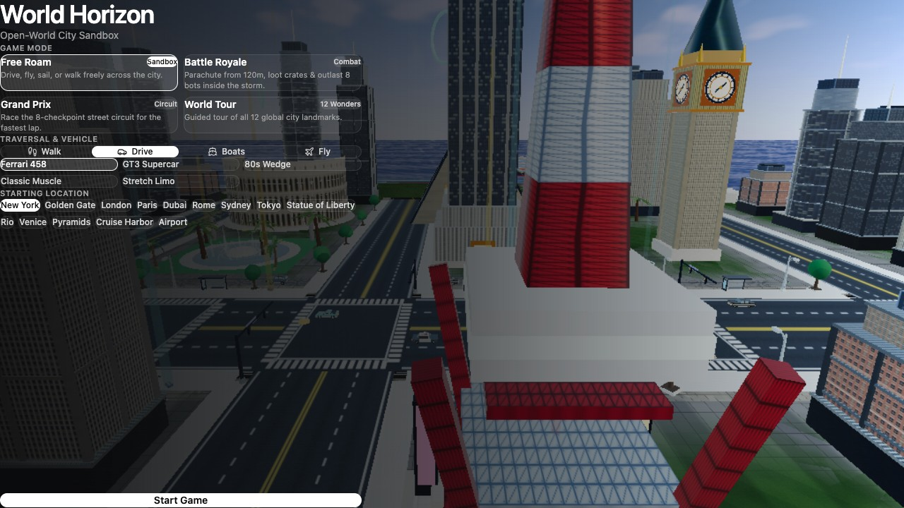

### Four Distinct Game Modes

| Mode | Objective & Gameplay | Dedicated HUD |
| --- | --- | --- |
| **Free Roam** | Explore the open city freely — drive supercars, fly jets & helicopters, captain cruise ships & yachts, or walk and customize your outfit. | Clean minimal HUD with minimap, speedometer, wardrobe, and fast travel. |
| **Battle Royale** | Sky-drop from 120m with a steerable parachute, loot supply & ammo crates, stay inside the shrinking storm ring, and eliminate 8 armed AI combatants. | Live `Alive`, `Elims`, `Storm` radius strip, Health/Shield bars, and 5-slot weapon loadout. |
| **Grand Prix** | High-speed 8-checkpoint street circuit down Grand Central Avenue, Golden Gate Bridge, Eiffel Blvd, and Colosseum Straight. | Live `Lap`, `Gate X / 8`, next gate distance, `Lap Time`, `Best Lap`, and `Drift Score`. |
| **World Tour** | Guided sightseeing tour across all 12 global city landmarks with architectural notes and progress tracking. | Live Monument Card (`X / 12`), city badge, description, and one-tap **Next Landmark** warp. |

---

## 2. Mode-by-Mode Gameplay Gallery

### Free Roam — Unobstructed Grand Central Avenue
Wide 4-lane textured asphalt avenues, zebra crosswalks, overhead LED traffic signal gantries, sidewalk bus shelters, deciduous street trees, and multi-part architectural skyscrapers (curtain-wall glass towers, cylindrical high-rises, Art Deco limestone towers, and urban brick mid-rises).

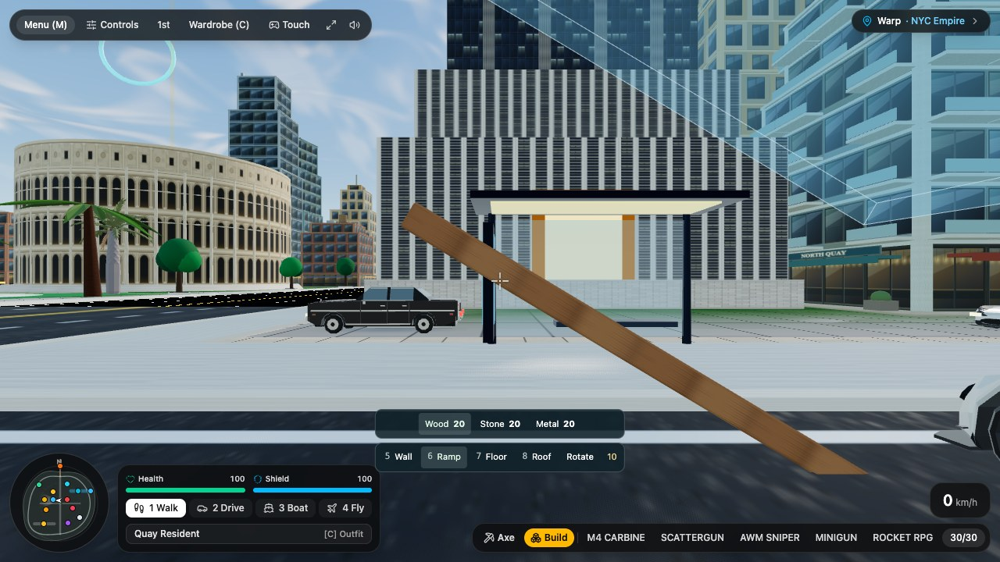

### Grand Prix Race — Golden Gate Bridge Approach
Snap into the 8-checkpoint street circuit with live lap timing, drift combos, and responsive supercar handling across the 44m-wide International Orange Golden Gate Suspension Bridge.

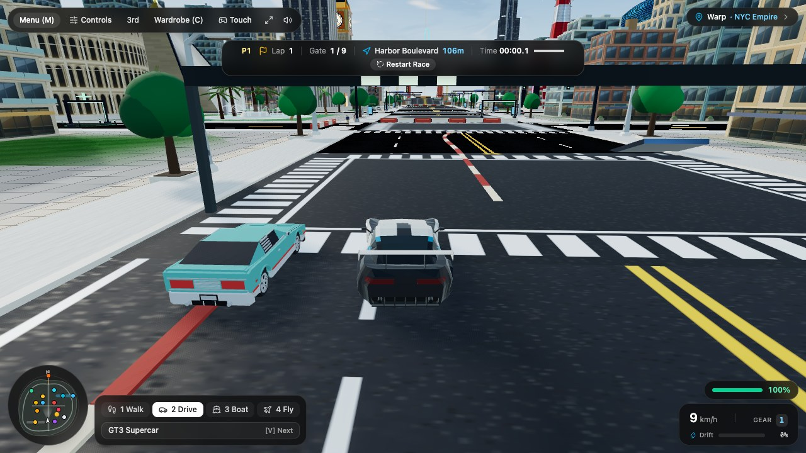

### Battle Royale — 120m Parachute Sky-Drop
Deploy from 120 meters above the city with a steerable ram-air parachute, shrinking storm ring, and 5-slot 3D weapon loadout (*M4 Carbine*, *Scattergun*, *AWM Sniper*, *Minigun*, *Rocket RPG*).

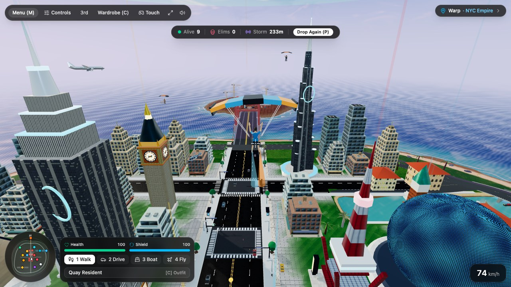

---

## 3. World Tour — 12 Iconic Global Landmarks

Every landmark sits in its own off-street urban plaza with custom procedural PBR masonry, metal, ceramic, and stone textures — zero roadblocks on the avenues.

### Rome — The Colosseum
Three stacked tiers of semi-circular travertine Roman arches with engaged columns and tiered interior cavea seating.

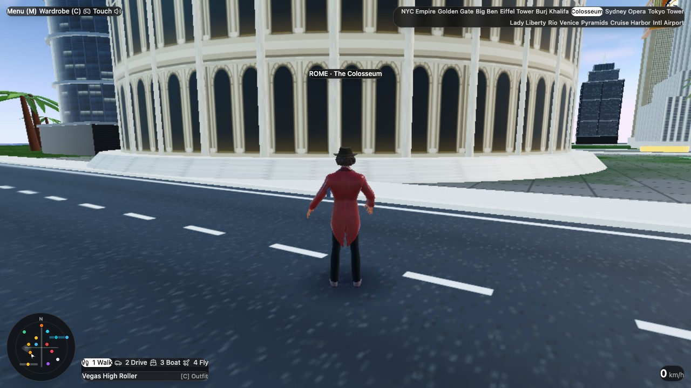

### Sydney — Opera House
Monumental ribbed granite Bennelong Point harbor podium, ceremonial grand steps, and six interlocking pointed ceramic sail shells.

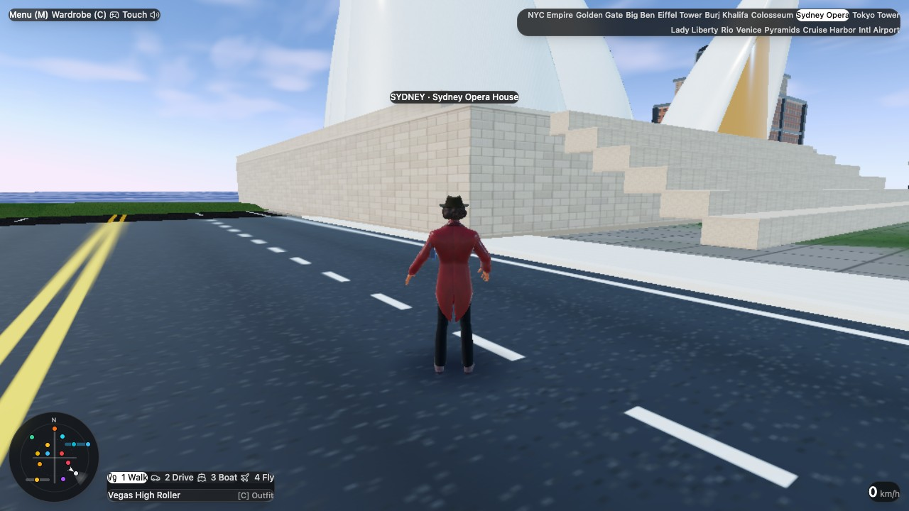

### Paris — Eiffel Tower & Champ de Mars
Four angled stone pier foundations on a manicured Champ de Mars lawn, symmetrical semicircular iron base arches, and 3D diagonal iron lattice trusses.

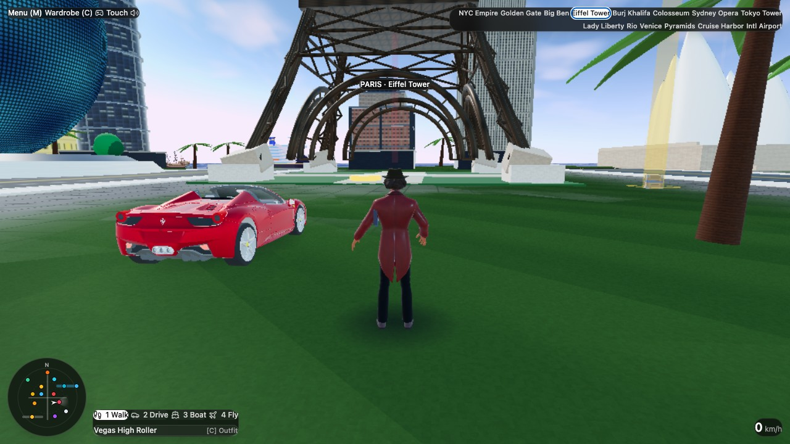

### London — Big Ben & Westminster Clock Tower
Neo-Gothic carved limestone belfry with four illuminated opal-glass clock dials and animated 3D hour and minute hands.

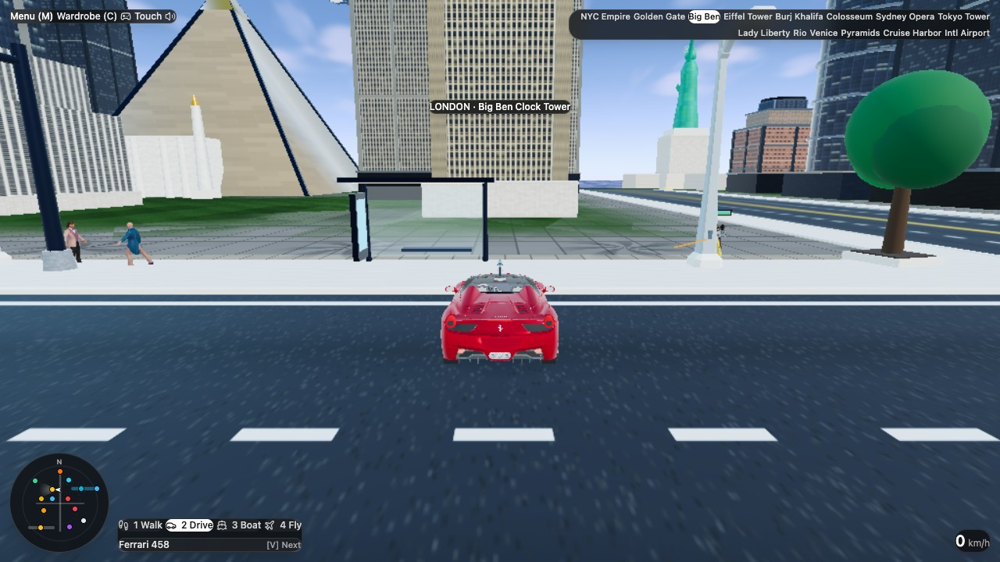

### Complete 12-Landmark Roster
1. **New York** — Empire State Building (`[-52, -28]`)
2. **San Francisco** — Golden Gate Suspension Bridge (`[0, -205]`)
3. **London** — Big Ben Clock Tower (`[-52, -88]`)
4. **Paris** — Eiffel Tower & Champ de Mars (`[95, 35]`)
5. **Dubai** — Burj Khalifa 128m Megatall Spire (`[54, -148]`)
6. **Rome** — The Colosseum (`[-105, 45]`)
7. **Sydney** — Sydney Opera House (`[148, 108]`)
8. **Tokyo** — Tokyo Tower & Shibuya Neon Plaza (`[52, -28]`)
9. **New York Harbor** — Statue of Liberty & 11-Point Star-Fort (`[-158, -145]`)
10. **Rio de Janeiro** — Christ the Redeemer on Corcovado Peak (`[58, 148]`)
11. **Venice** — Rialto Bridge, Grand Canal & St. Mark's Campanile (`[135, -95]`)
12. **Cairo / Giza** — Great Pyramid & Twin Obelisks (`[-118, -28]`)

---

## 4. Maritime, Aviation & 3D Character Studio

### Maritime & Mega-Cruise Ship Fleet (6 Playable Vessels)
Captain the **Oasis Cruise Ship**, **Cigarette Racing Powerboat**, **Royal Tall Ship**, **Mediterranean Sloop Yacht**, **Aegean Motor Yacht**, or **Deep-Sea Submarine** alongside two 7-deck offshore Mega-Cruise Ships.

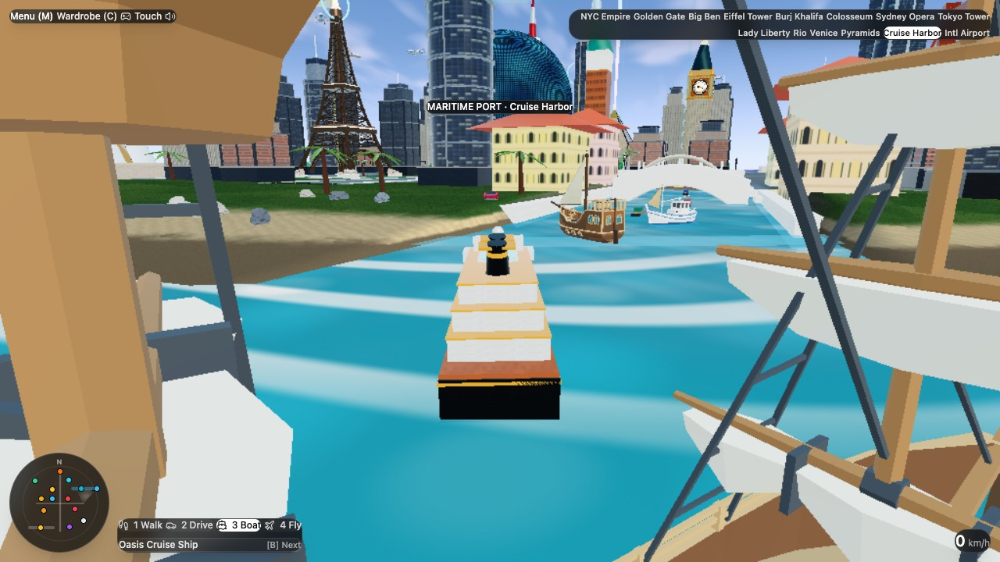

### Aviation & Helicopter Fleet (6 Playable Aircraft)
Fly the **Bell VIP Helicopter**, **Gulfstream G700 Jet**, **Mustang Strike Fighter**, **Twin Regional Turboprop**, **Boeing 737 Airliner**, or **Heavy Strategic Cargo Jet** through the city skyline.

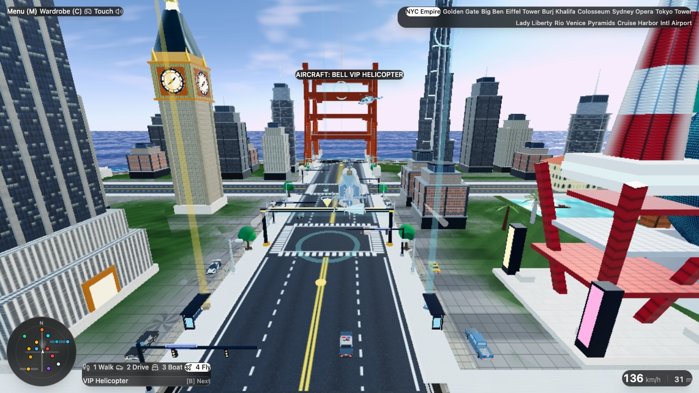

### Live 3D Character & Wardrobe Studio (`C`)
Swing the camera into a 3/4 portrait studio view to customize your character's preset, base human rig, jacket color & finish (*Matte / Satin / Leather*), pants, shoes, skin tone, cap, beard, eyewear (*Aviators / Cyber Visor*), and tactical backpack in real time.

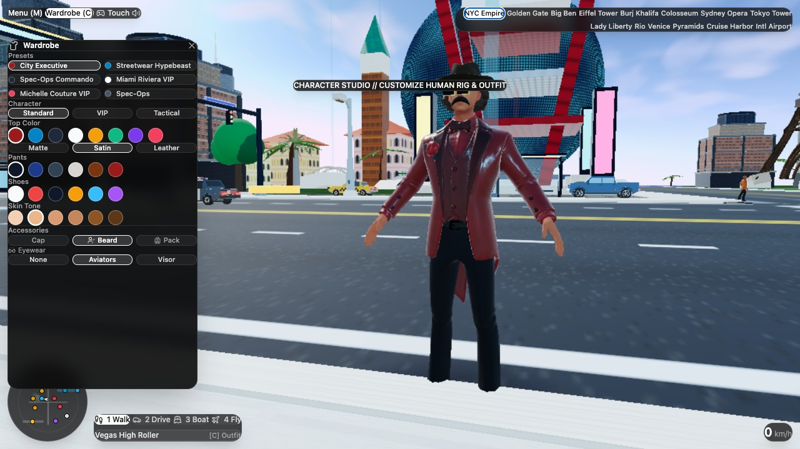

---

## 5. Mobile & Touch-Screen Gameplay (`390×844`)

Full native touch-screen support with `100dvh` viewport locking, auto-detected touch UI (plus a one-tap **Touch** toggle on any device), a **360° virtual analog thumb joystick**, ergonomic right-thumb action buttons (**Fire**, **Drift / Jump / Brake**, **Boost**, **Switch Vehicle**), and a compact **Teleport** dropdown.

  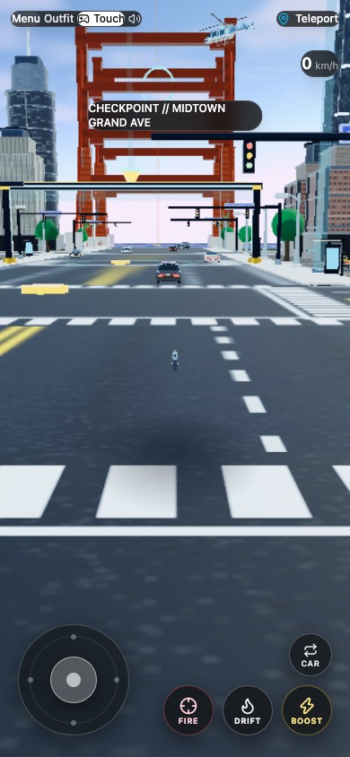

---

## Controls Quick Reference

| Action | Desktop Keyboard | Mobile Touch |
| --- | --- | --- |
| Move / Steer / Pitch | `W A S D` / Arrow Keys | Left Virtual Analog Joystick |
| Boost / Sprint | `Shift` | Right Thumb **Boost** |
| Jump / Drift / Brake | `Space` | Right Thumb **Jump / Drift** |
| Fire Weapon | `F` or Left Click | Right Thumb **Fire** |
| Switch Mode / Start Screen | `M` / `Esc` / `Tab` | Top-Left **Menu** Button |
| Quick Mode Keys | `1` Walk · `2` Drive · `3` Boat · `4` Fly | Bottom Mode Bar / Menu |
| Cycle Car / Plane / Boat | `V` (Car) · `B` (Plane / Boat) | Right Thumb **Cycle** Button |
| 3D Wardrobe Studio | `C` | Top-Left **Outfit** Button |
| 120m Parachute Sky-Drop | `P` | **Sky-Drop** Button |
