# World Horizon — Complete Character Showcase (25 Playable Characters)

Every playable character in **World Horizon** (`azurea-coastline-openworld`) rendered in-engine on the Azurea Harbor Pavilion Hero Stage. All characters are rigged and driven by `createHumanoidRig()` + `animateHumanoid()` with 2-bone leg IK, procedural gait, swimming, parachuting, and 5 selectable emotes (`Riviera Wave`, `Club Groove`, `Victory Spin`, `Champion Flex`, `Harbor Shuffle` — press **`[Z]`** in-game).

---

## 1. Tripo3D Mixamo-Rigged Originals & Outfit Variants (14 Characters)

Generated via the local **Tripo 3D Studio** (`npm run tripo-studio`, `v2.5-20250123`) and auto-rigged with Mixamo biped skeletons (**23 joints** each).

### Sport, Streetwear & Riviera

#### 1. Elena · Sport Pro (`TRIPO_NIKE_BRUNETTE`)
- **Model**: `public/models/characters/tripo-nike-brunette.glb` · **Height**: `1.72 m` · **Rig**: Mixamo Biped (23 joints)
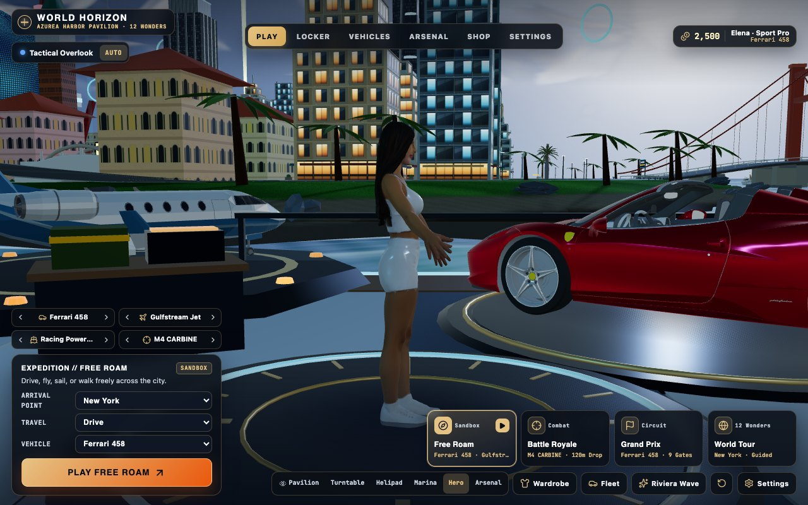

#### 2. Chloe · Sport Pro (`TRIPO_NIKE_BLONDE`)
- **Model**: `public/models/characters/tripo-nike-blonde.glb` · **Height**: `1.72 m` · **Rig**: Mixamo Biped (23 joints)
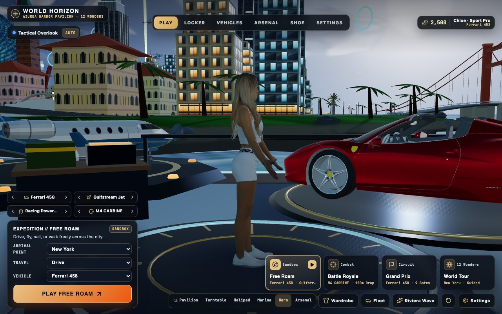

#### 3. Elena · Moto (`TRIPO_NIKE_BRUNETTE_MOTO`)
- **Model**: `public/models/characters/tripo-nike-brunette-moto.glb` · **Height**: `1.72 m` · **Rig**: Mixamo Biped (23 joints)
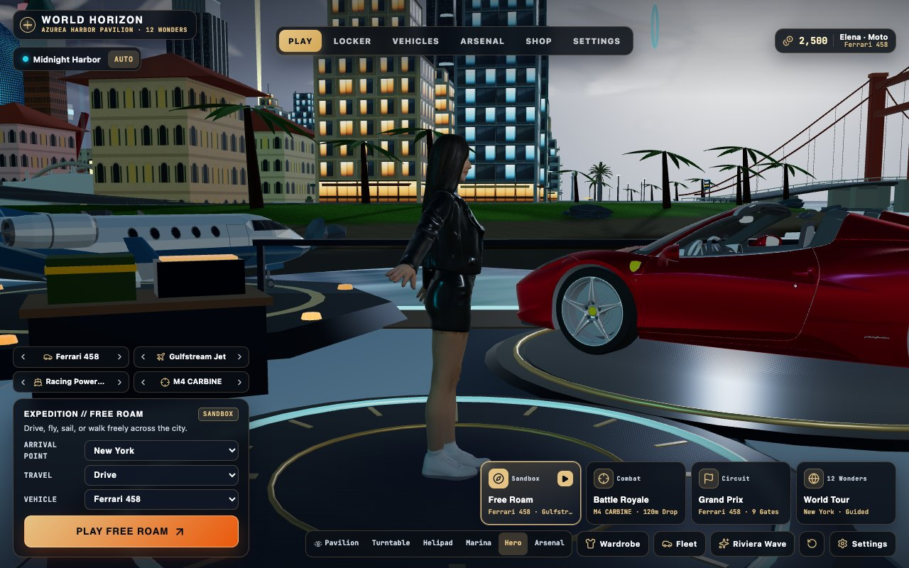

#### 4. Chloe · Varsity (`TRIPO_NIKE_BLONDE_VARSITY`)
- **Model**: `public/models/characters/tripo-nike-blonde-varsity.glb` · **Height**: `1.72 m` · **Rig**: Mixamo Biped (23 joints)
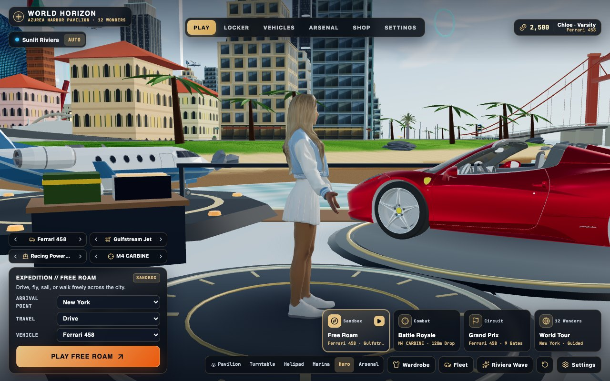

#### 5. Sienna · Riviera (`TRIPO_RIVIERA_GOLD_GIRL`)
- **Model**: `public/models/characters/tripo-riviera-gold-girl.glb` · **Height**: `1.72 m` · **Rig**: Mixamo Biped (23 joints)
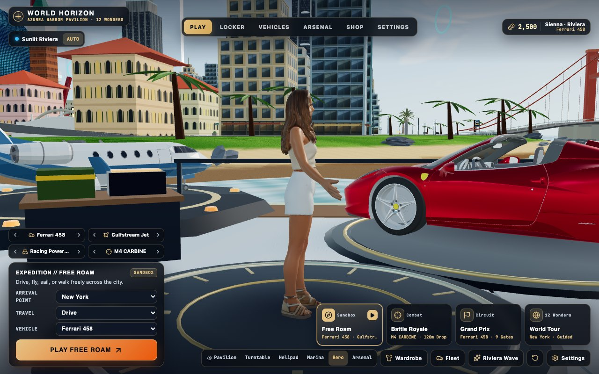

---

### Cyber, Tactical & Holiday

#### 6. Nova · Neon (`TRIPO_CYBER_PINK`)
- **Model**: `public/models/characters/tripo-cyber-pink.glb` · **Height**: `1.72 m` · **Rig**: Mixamo Biped (23 joints)

#### 7. Aria · Chrome (`TRIPO_CYBER_SILVER_GIRL`)
- **Model**: `public/models/characters/tripo-cyber-silver-girl.glb` · **Height**: `1.72 m` · **Rig**: Mixamo Biped (23 joints)

#### 8. Vesper · Spider (`TRIPO_SPIDER_BLONDE`)
- **Model**: `public/models/characters/tripo-spider-blonde.glb` · **Height**: `1.72 m` · **Rig**: Mixamo Biped (23 joints)

#### 9. Valkyrie · Blonde (`TRIPO_TACTICAL_BLONDE`)
- **Model**: `public/models/characters/tripo-tactical-blonde.glb` · **Height**: `1.73 m` · **Rig**: Mixamo Biped (23 joints)
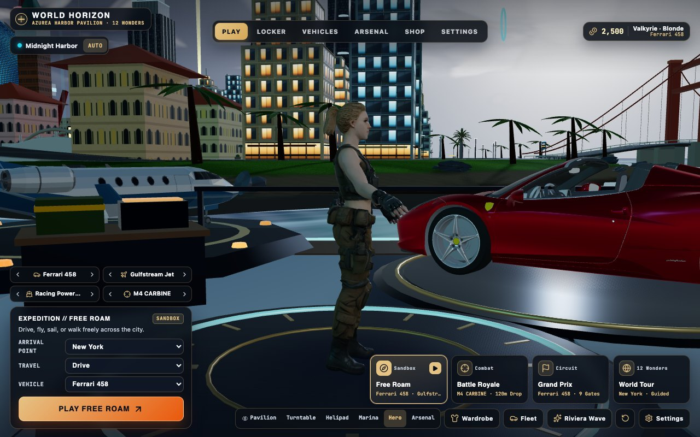

#### 10. Scarlet · Tactical (`TRIPO_TACTICAL_REDHEAD`)
- **Model**: `public/models/characters/tripo-tactical-redhead.glb` · **Height**: `1.73 m` · **Rig**: Mixamo Biped (23 joints)
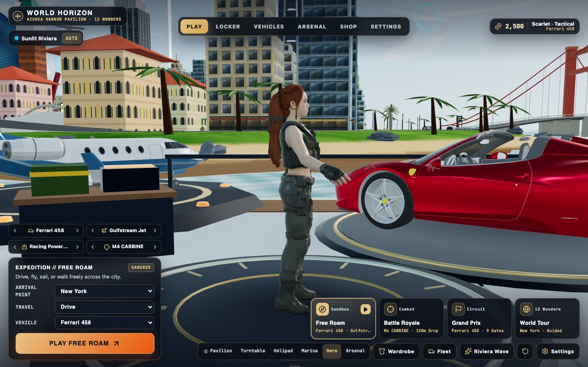

#### 11. Bella · Holiday (`TRIPO_SANTA_BLONDE`)
- **Model**: `public/models/characters/tripo-santa-blonde.glb` · **Height**: `1.72 m` · **Rig**: Mixamo Biped (23 joints)

#### 12. Camila · Holiday (`TRIPO_SANTA_BRUNETTE`)
- **Model**: `public/models/characters/tripo-santa-brunette.glb` · **Height**: `1.72 m` · **Rig**: Mixamo Biped (23 joints)
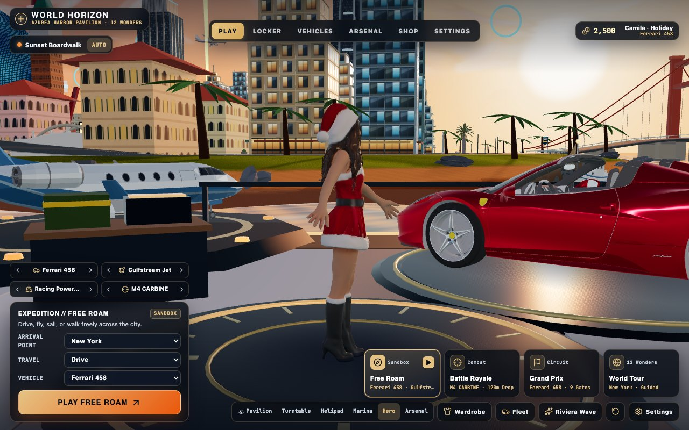

---

### Sleek Robotics

#### 13. Aegis · Titanium Bot (`TRIPO_ROBOT_TITANIUM`)
- **Model**: `public/models/characters/tripo-robot-titanium.glb` · **Height**: `1.82 m` · **Rig**: Mixamo Biped (23 joints)
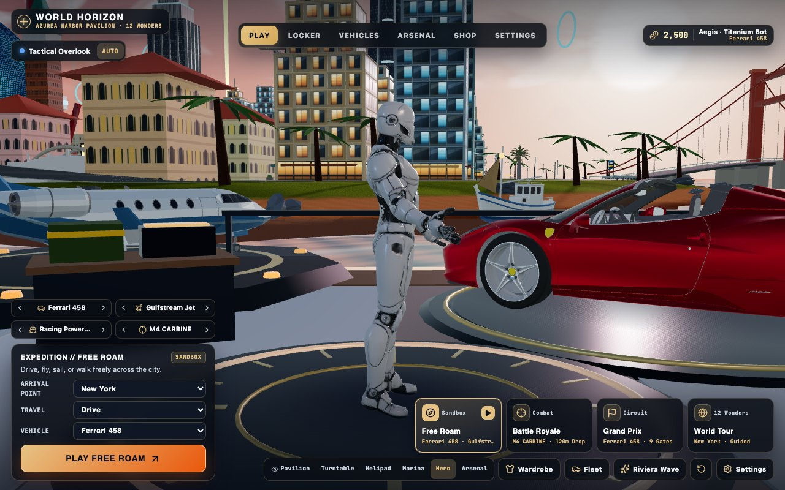

#### 14. Solstice · Gold Bot (`TRIPO_ROBOT_OBSIDIAN_GOLD`)
- **Model**: `public/models/characters/tripo-robot-obsidian-gold.glb` · **Height**: `1.82 m` · **Rig**: Mixamo Biped (23 joints)
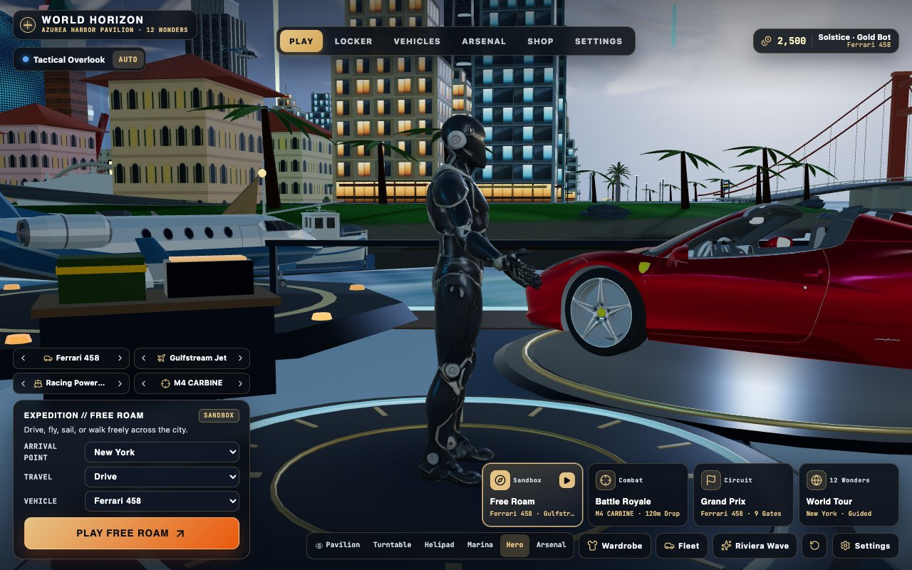

---

## 2. Harbor Crew, Androids & Coastal Residents (8 Characters)

#### 15. Apex Android (`XBOT_CYBER`)
- **Model**: `public/models/xbot.glb` · **Height**: `1.82 m`

#### 16. Executive VIP (`HIGH_ROLLER_VIP`)
- **Model**: `public/models/human_high_roller.glb` · **Height**: `1.80 m`
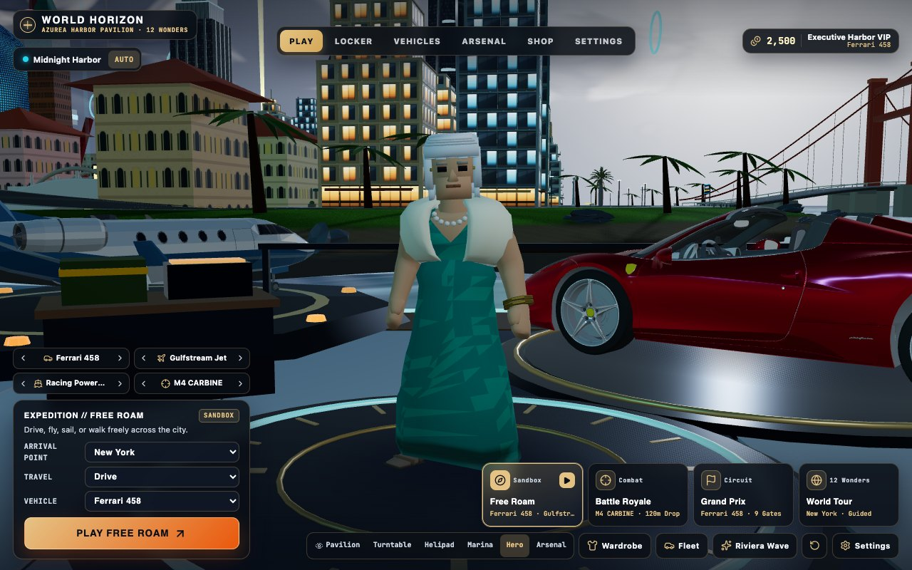

#### 17. Harbor Commander (`COMMANDER_OPS`)
- **Model**: `public/models/human_commander.glb` · **Height**: `1.82 m`
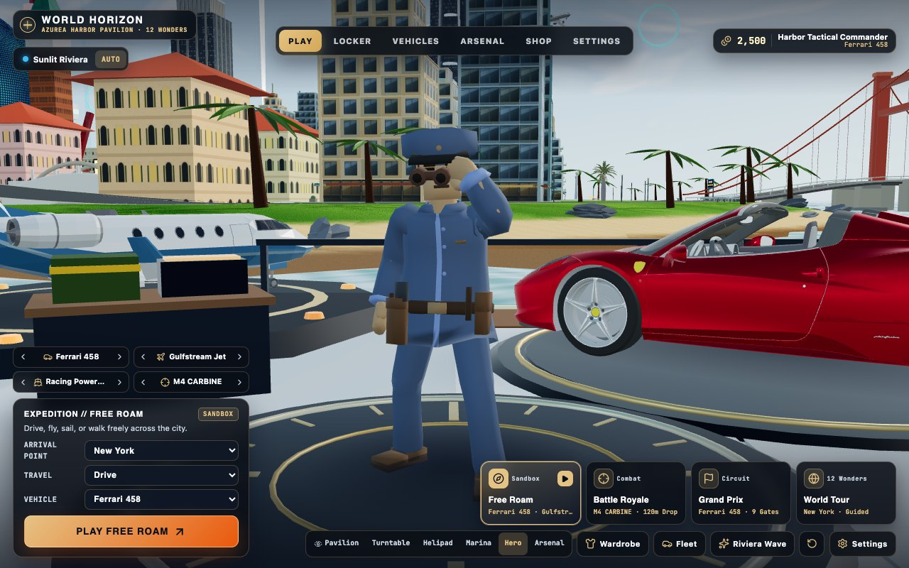

#### 18. Field Medic (`SPEC_OPS_MEDIC`)
- **Model**: `public/models/human_medic.glb` · **Height**: `1.80 m`

#### 19. Rescue Pilot (`RESCUE_PILOT`)
- **Model**: `public/models/characters/coastal-rescue-pilot.glb` · **Height**: `1.86 m`

#### 20. Harbor Navigator (`COAST_NAVIGATOR`)
- **Model**: `public/models/characters/harbor-navigator.glb` · **Height**: `1.76 m`

#### 21. Quay Resident (`CIVILIAN_MAN`)
- **Model**: `public/models/characters/quaternius-man.glb` · **Height**: `1.76 m`

#### 22. Harbor Resident (`CIVILIAN_WOMAN`)
- **Model**: `public/models/characters/quaternius-woman-casual.glb` · **Height**: `1.68 m`
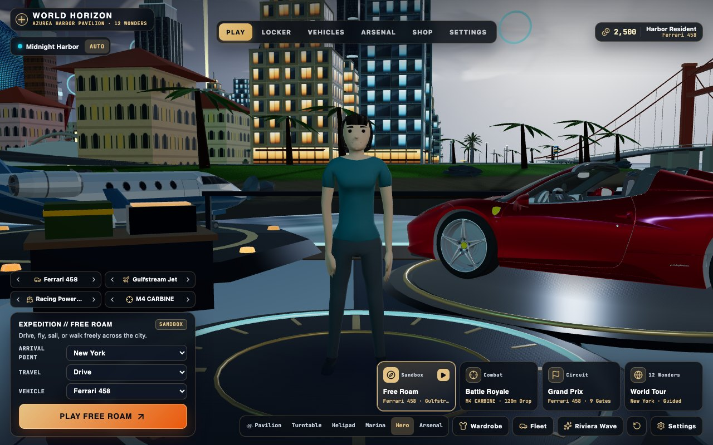

---

## 3. Core Studio & Hero Archetypes (3 Characters)

#### 23. City Runner (`RPM_CUSTOM`)
- **Customizable Wardrobe Archetype** (supports Studio outfits, hair, skin, eyewear, headwear, and packs)

#### 24. Michelle (`MICHELLE_VIP`)
- **Samba / VIP Hero Archetype** (`public/models/michelle.glb`)

#### 25. Vanguard (`VANGUARD_SOLDIER`)
- **Tactical Vanguard Archetype** (`public/models/soldier.glb`)
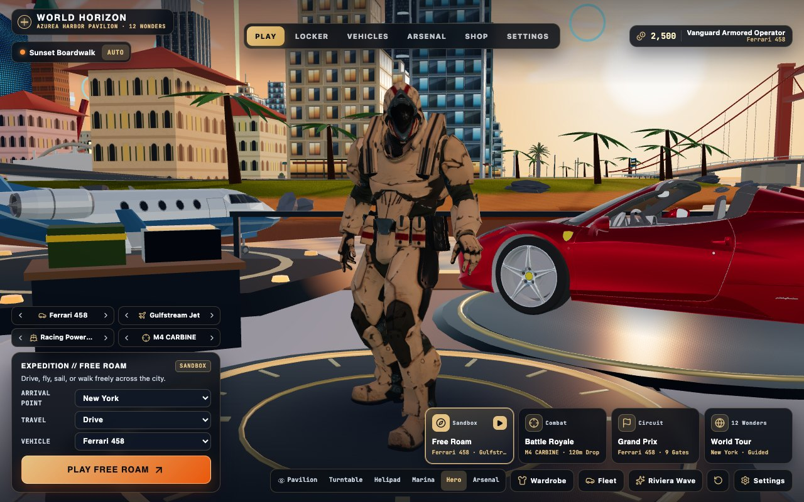
