# World Horizon — Showcase & Feature Guide

**World Horizon** (`azurea-coastline-openworld`) is a Three.js / React Three Fiber open-world coastal sandbox featuring a 4-theme rotating Pavilion Lobby, **Tripo `v3.1-20260211` HD** rigged hero characters (**Chloe Reed** with 5 costumes, **Lola Quinn** with 4 costumes, **Marcus Vance**, **Liam Sterling**, robotics, and Harbor Crew), Kit Colorways, 5 selectable emotes, 22,000-clump instanced 3D meadow grass, responsive supercar driving & pointer-lock 1st/3rd-person shooting, 12 World Wonders, and the **Wonder Ocean Pier Amusement Park**.

---

## 1. Flagship `v3.1` Heroes, Costumes & Kit Colorways

- **Chloe Reed (`v3.1` HD)** with 5 costumes (`Nike Pro Base`, `Emerald Club`, `Silver Spider`, `Varsity Sport`, `Holiday Velvet`) and **Lola Quinn (`v3.1` HD)** with 4 costumes (`Nike Pro Base`, `Bomber Street`, `Moto Leather`, `Holiday Velvet`), plus 7 real-time **Athletic Kit Colorways** on their Nike Pro bases (`uKitTint` shader hook).
- **Male `v3.1` HD Heroes**: `Marcus Vance` and `Liam Sterling`.
- **Natural Shading & Mixamo Mocap**: Preserves baked normal maps, applies matte-satin skin/cotton calibration, auto-aligns `+Z` facing, and retargets `idle`/`walk`/`run`/`SambaDance` motion capture clips across all Mixamo rigs. On-demand lazy GLB loading keeps startup fast.

| Chloe Reed (Azurea Kit) | Chloe Reed (Emerald Club) | Lola Quinn (Bomber Street) | Marcus Vance & Liam Sterling |
| --- | --- | --- | --- |
| 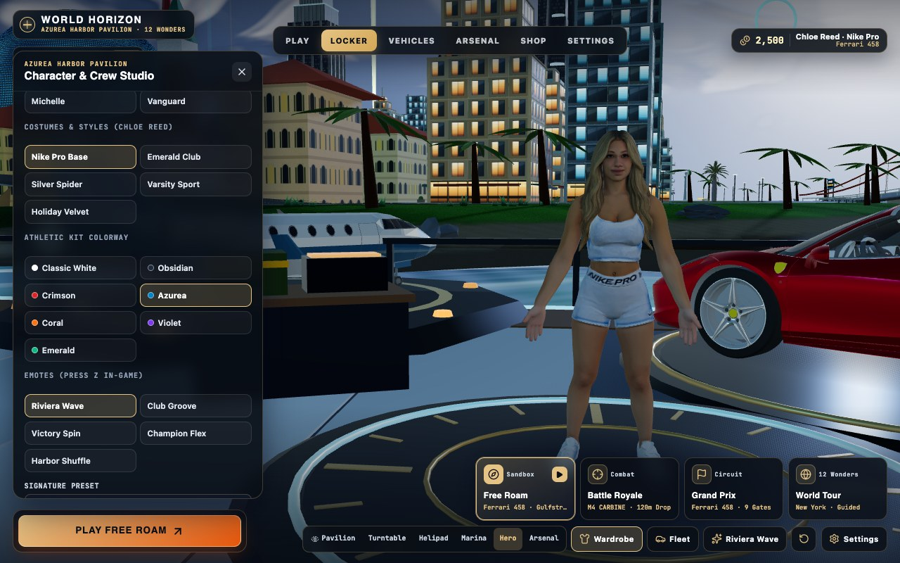 |  | 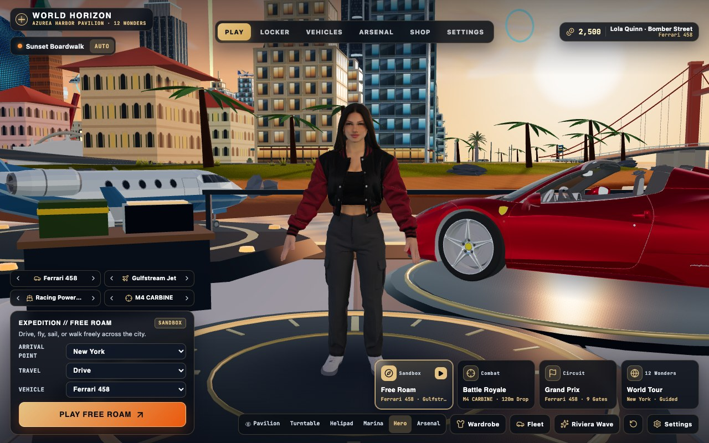 | 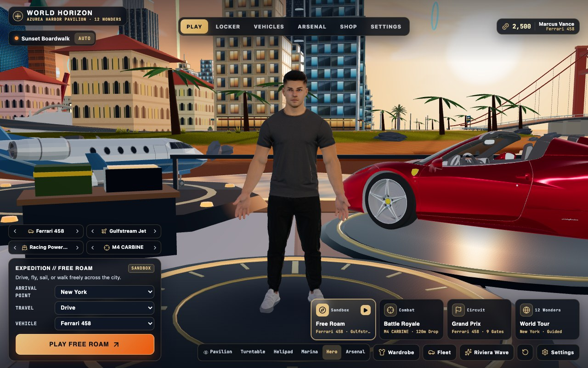 |

---

## 2. Dense 22,000-Clump 3D Grass, Supercar Driving & Pointer-Lock Shooting

- **Lush 22,000-Clump 7-Blade Grass** with GPU hardware distance LOD culling (`78–125m` taper) and natural fescue/olive/soil color harmony across parks, boulevards, and Island II.
- **Snappy Supercar Driving**: Low-speed steering response, high-speed turn authority, launch torque curve, progressive slip & drift chase camera.
- **True Pointer-Lock 1st/3rd-Person Aim & Shooting**: Clicking locks the cursor for 1:1 mouse aim (`[Esc]` unlocks cursor without kicking to Menu), barrel-origin tracers, compact 1st-person viewmodel & muzzle flash, camera recoil kick, and 60fps reactive reticle spread.

| Supercar & Lush 3D Grass | First-Person Pointer-Lock Shooting |
| --- | --- |
|  | 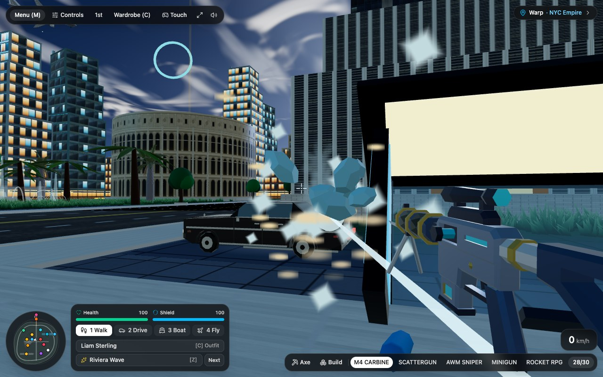 |

---

## 3. Localhost Tripo 3D Studio (`npm run tripo-studio`)

Run `npm run tripo-studio` to launch the local Tripo3D Asset Forge at `http://127.0.0.1:4321`.

- Defaults to **`v3.1-20260211` Flagship H3.1 HD** + `Detailed HD` textures + `36,000` face limit.
- **Automatic Mixamo Biped Rigging** (`animate_rig`, `spec: "mixamo"`, 23 joints) saving `.glb` files directly into `public/models/characters/` with an ACES Filmic sRGB Three.js 3D previewer.

---

## 2. Five Selectable Emotes (Lobby & In-Game `[Z]`)

Choose any of the 5 procedural full-body emotes in the Wardrobe drawer, cycle them from the bottom-right Lobby utility bar, or trigger them on foot in-game with **`[Z]`** or the HUD Emote pill:

1. **Riviera Wave** (`WAVE`)
2. **Club Groove** (`DANCE`)
3. **Victory Spin** (`SPIN`)
4. **Champion Flex** (`FLEX`)
5. **Harbor Shuffle** (`SHUFFLE`)

---

## 3. Rotating Pavilion Lobby & 4 Dynamic Atmosphere Themes

All 4 lobby themes share a unified core layout with the bottom-right Game Options icon bar (`Overview`, `Turntable`, `Helipad`, `Marina`, `Hero`, `Arsenal`, `Wardrobe`, `Fleet`, `Emote`, `Reset`, `Settings`).

| Theme | Preview |
| --- | --- |
| **Sunlit Riviera** |  |
| **Sunset Boardwalk** |  |
| **Tactical Overlook** |  |
| **Midnight Harbor** | 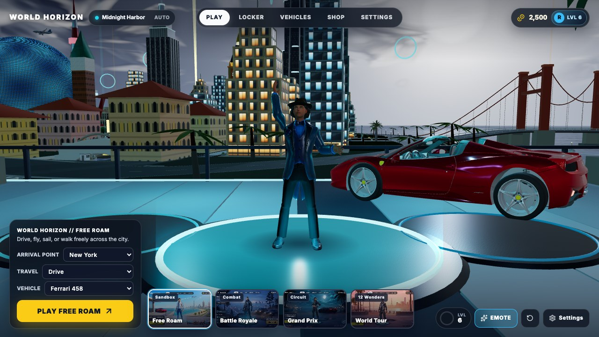 |

---

## 4. Wonder Ocean Pier Amusement Park (Ridable)

Extending off Island II into the open ocean, the **Wonder Ocean Pier** features 4 ridable attractions (`[E]` to board/exit):
- **Solaris Ferris Wheel** (rotating gondolas with panoramic coastline views)
- **Cyclone Pier Coaster** (elevated track loop over the water)
- **Grand Carousel** & **Apex Drop Tower**

| Pier Overview | Solaris Ferris Wheel | Cyclone Coaster |
| --- | --- | --- |
|  | 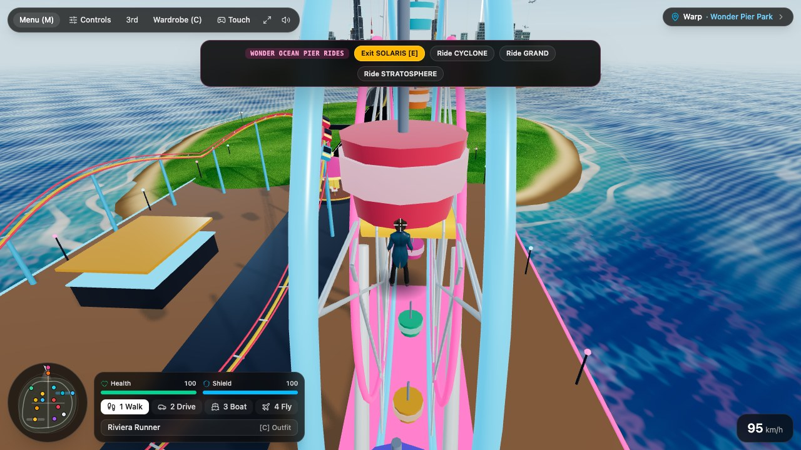 |  |

---

## 5. Open-World Modes, Landmarks & Fleet

| Mode / Landmark | Screenshot |
| --- | --- |
| **Free Roam Avenue** | 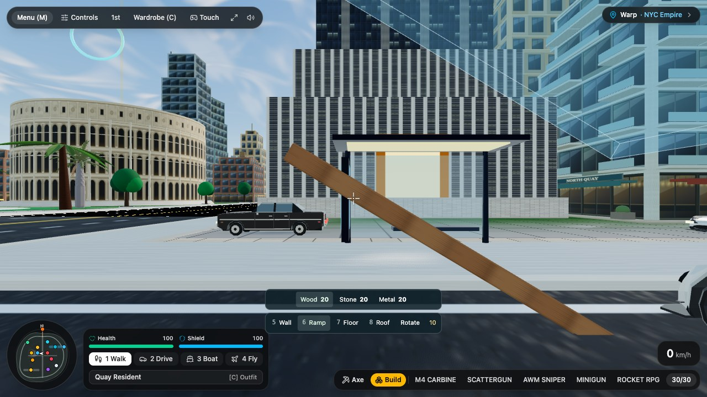 |
| **Grand Prix (Golden Gate)** |  |
| **Battle Royale Skydrop** | 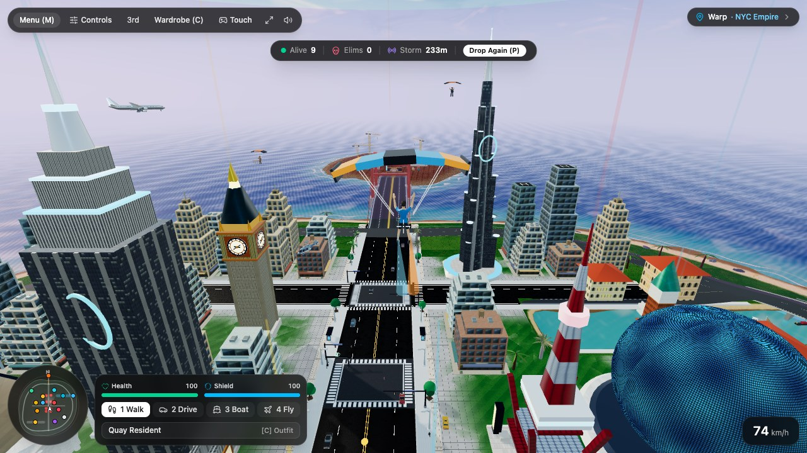 |
| **World Tour · Colosseum** |  |
| **World Tour · Sydney Opera House** |  |
| **World Tour · Eiffel Tower** | 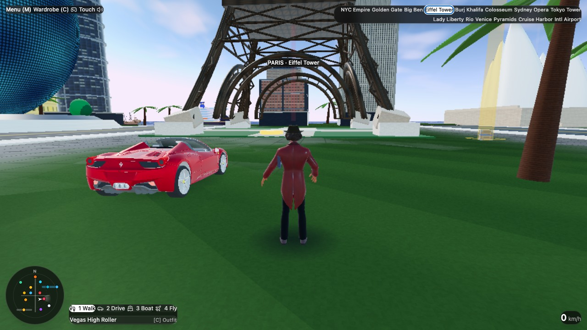 |
| **World Tour · Big Ben** |  |
| **Maritime · Cruise Ship & Ocean** | 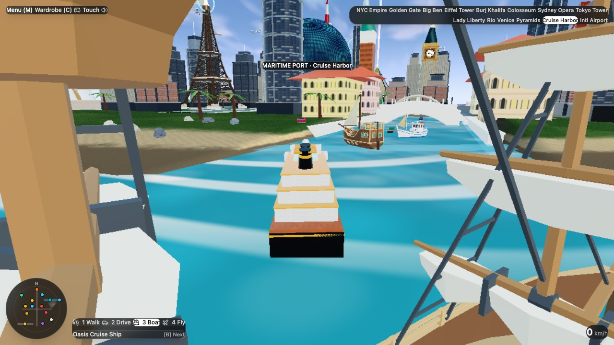 |
| **Aviation · Helicopter** |  |
| **Aviation · Gulfstream Coast** | 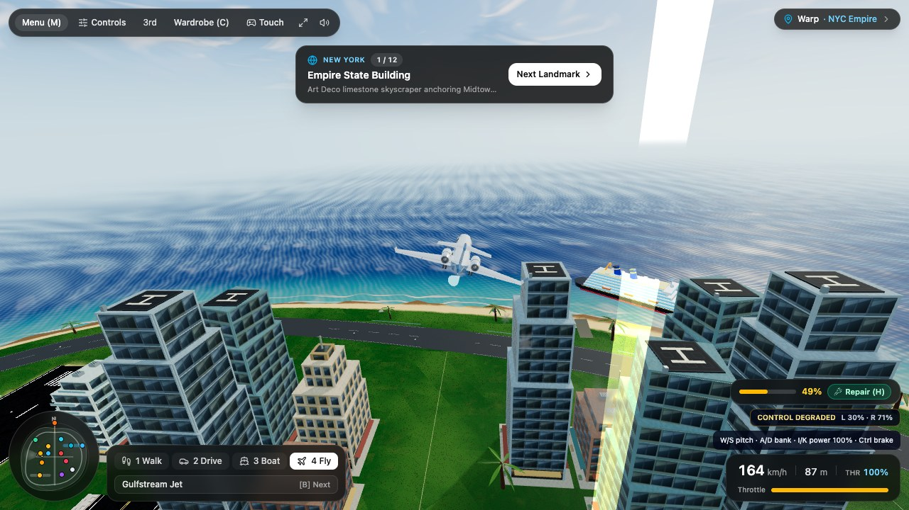 |
| **Mobile Touch Controls** | 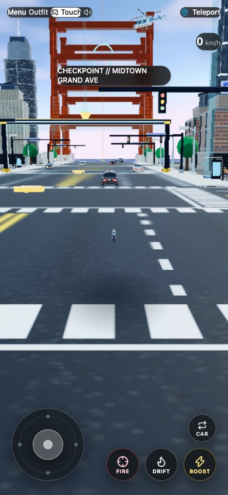 |
