# World Horizon — Showcase & Feature Guide

**World Horizon** (`azurea-coastline-openworld`) is a Three.js / React Three Fiber open-world coastal sandbox featuring an expanded Riviera island (+33.8% dry coastal footprint), two offshore satellite islands (**Solis Lighthouse Atoll** & **Azurea Stunt Atoll**), Island II **Boardwalk Surf Village**, a whimsical **Quirky Coastal World** (Sir Quacks-a-Lot giant golden duck buoy, retro bounce trampolines, 4 Azurea Postcard vintage photo frames, physics beach balls, leaping dolphin pod, offshore hydro-boost aqua rings, interactive Wonder Pier Prize Wheel, and mirroring Boardwalk Street Performer), sleek glassmorphism HUD & 5-island circular minimap, seated amusement ride poses, 2048px desktop shadows, **Tripo `v3.1-20260211` HD** rigged hero characters, 14 Fast-Travel Landmarks, and the animated **Wonder Ocean Pier Amusement Park**.

---

## Codex `gpt-6.2-sol` Coastal Horizon Overhaul — Sleek HUD, Satellite Atolls, Rigging & Quirky Quality

- **Sleek Zero-Clutter Glassmorphism HUD & 5-Island Minimap**: Top-center docked ride telemetry (zero overlap with bottom-left radar), auto-fading pointer-lock pill, context-aware reticle (hidden during casual 3rd-person exploration, swimming, and amusement rides), auto-hiding full 100/100 Free Roam vitals, deduplicated `Controls & Sensitivity` drawer with `Escape` close, dynamic landmark counter (`14 Landmarks`), upgraded circular radar plotting Main Island, Island II, Wonder Pier, Solis Lighthouse Atoll & Azurea Stunt Atoll, plus Polaroid discovery toasts and camera-flash feedback.
- **Bigger Map & Richer Destinations**: Two brand-new offshore satellite islands — **Solis Lighthouse Atoll** (rotating Fresnel-beam striped lighthouse, timber yacht jetty, sunset cliff-dive platform, tidepools) and **Azurea Stunt Atoll & Floating Marina Reef** (twin curved marine stunt ramps, floating pontoons, hydro-boost rings) — plus a bustling **Boardwalk Surf Village & Seaside Amphitheater** on Island II flanks, diversified Mediterranean villas & cafés across the main island, and an Art-Deco recessed bronze revolving-door Empire State entrance.
- **Crisper Graphics, Controls & Seated Character Rigging**: Upgraded `2048×2048` desktop directional shadows, softened beach sand & swimmer waterline speculars, clean fountain mist without floating blobs, daylight sky-mote height fade, Lobby Pavilion grass exclusion, no-gunshot pointer-lock click, 360° ride camera panning & unobstructed seaward Ferris wheel view, safe car exits & smart boat/plane spawns, ergonomic `Shift`/`Ctrl` flight throttle, seated ride poses (`FERRIS`, `COASTER`, `CAROUSEL`, `DROP_TOWER`), relaxed Tripo `v3.1` idle, fixed left-hand-on-hip `Riviera Wave` emote, and sidewalk-grounded coastal NPCs who wave & cheer on player emotes.
- **Quirky Coastal Personality (`QuirkyWorld.tsx`)**: **"Sir Quacks-a-Lot"** giant golden rubber duck yacht buoy with aviator shades & fountain-spout quack salute, 4 retro striped coastal bounce trampolines (`16m` spring launch), 4 collectible **"Azurea Postcard"** vintage photo frames, 6 physics-kickable giant beach balls + volleyball nets, leaping 5-dolphin pod, glowing hydro-boost aqua rings, interactive spinning Wonder Pier **Prize Wheel**, and a mirroring **Boardwalk Street Performer**.

| Clean Sunset Boardwalk Lobby | Sleek HUD, 5-Island Minimap & Empire State | Solis Lighthouse Atoll & Yacht Jetty | Azurea Stunt Atoll & Hydro Rings |
| --- | --- | --- | --- |
| 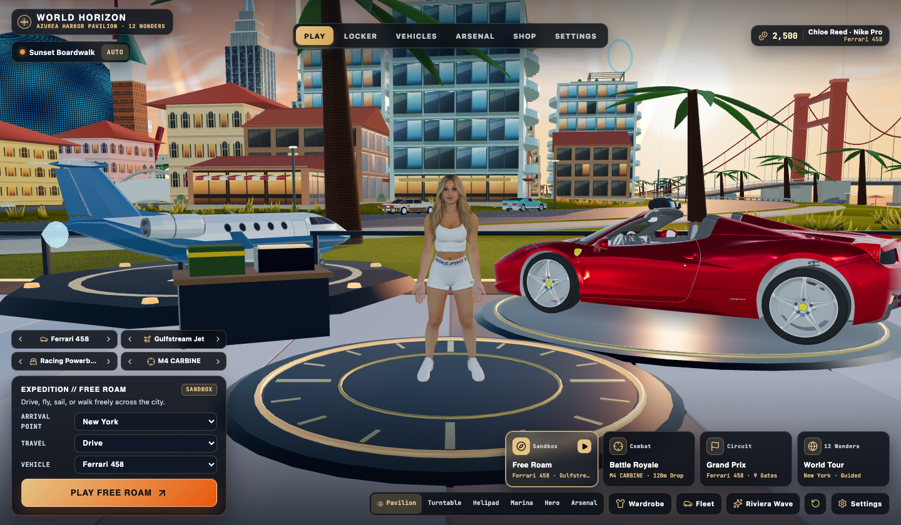 | 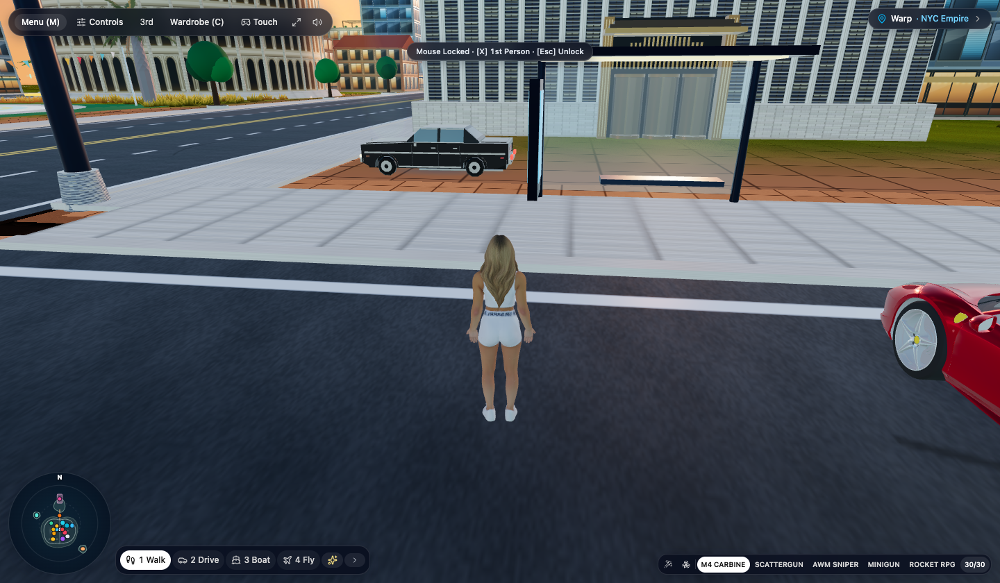 | 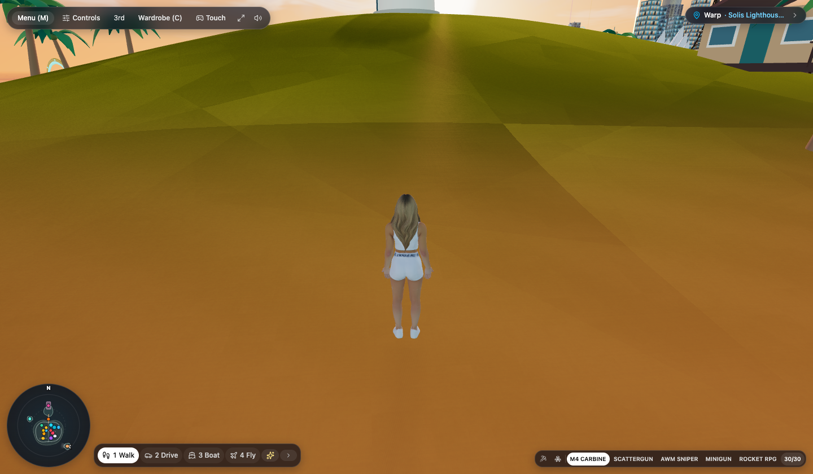 | 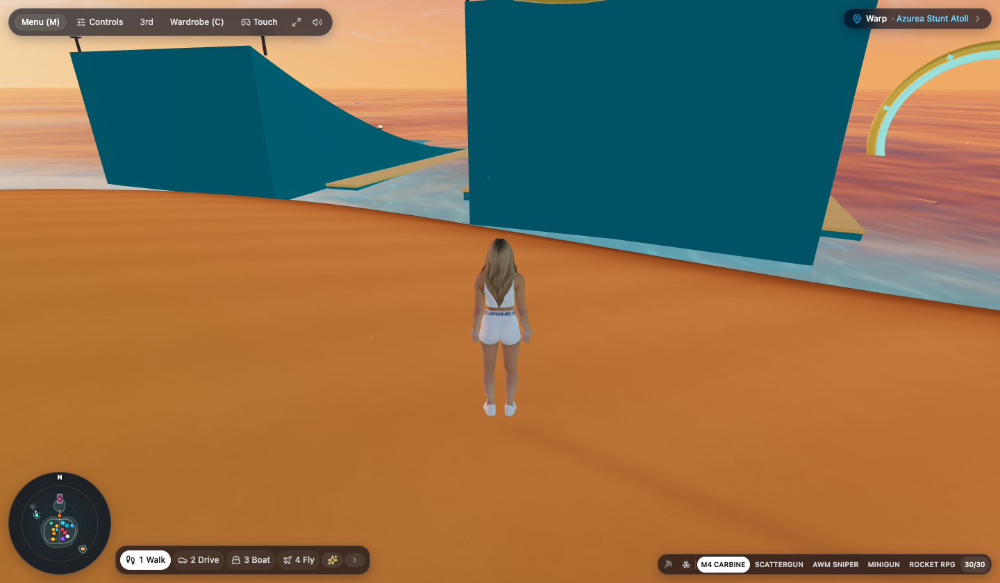 |

| Wonder Pier Postcard Frame & Midway | Seated Solaris Sky Wheel (Seaward Cam) | Reticle-Free Cyclone Coaster FPV | Riviera Wave Hip Tuck & Sir Quacks-a-Lot |
| --- | --- | --- | --- |
| 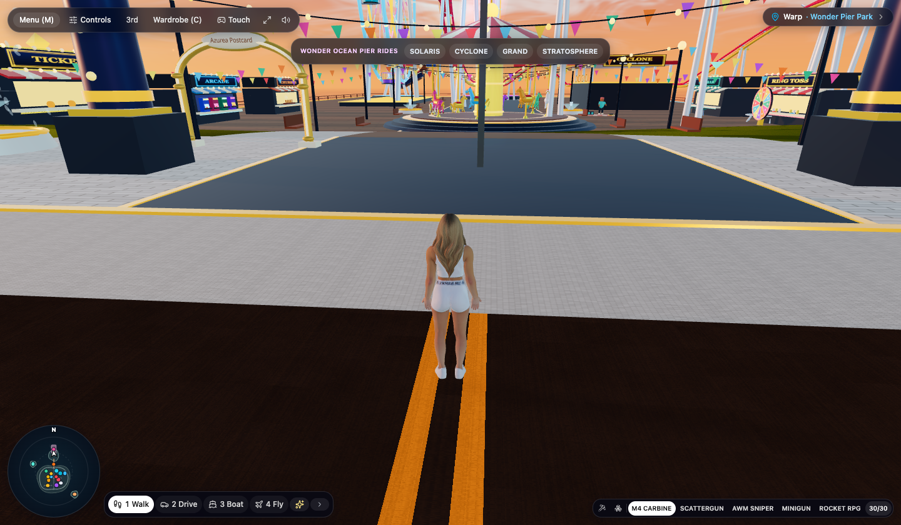 | 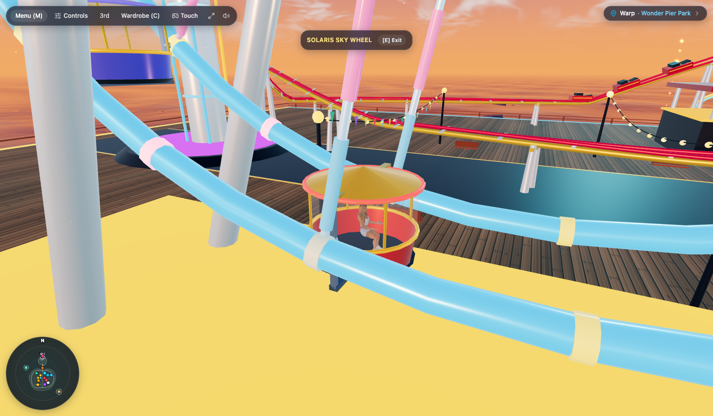 | 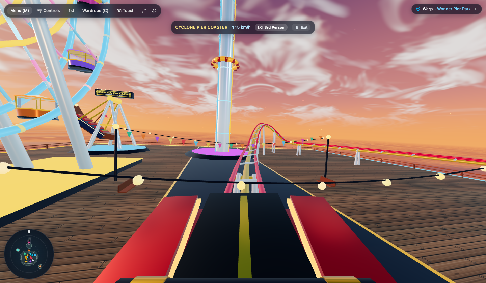 | 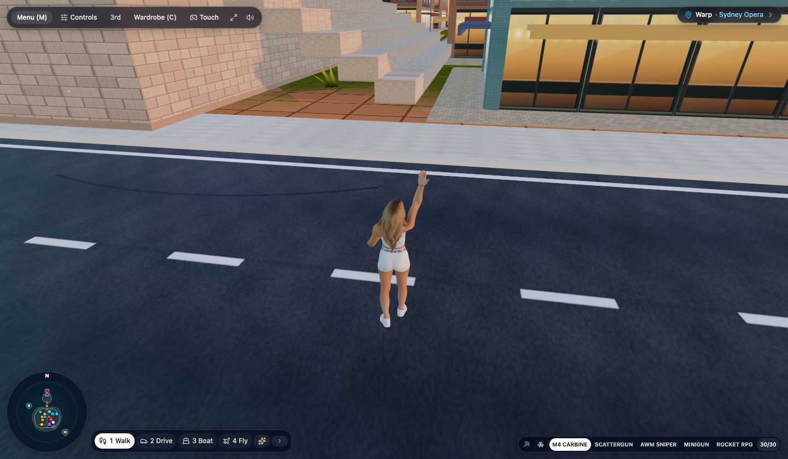 |

| Crystal Solis Tidepools & Sunset Water | South Beach & Sir Quacks-a-Lot Buoy |
| --- | --- |
| 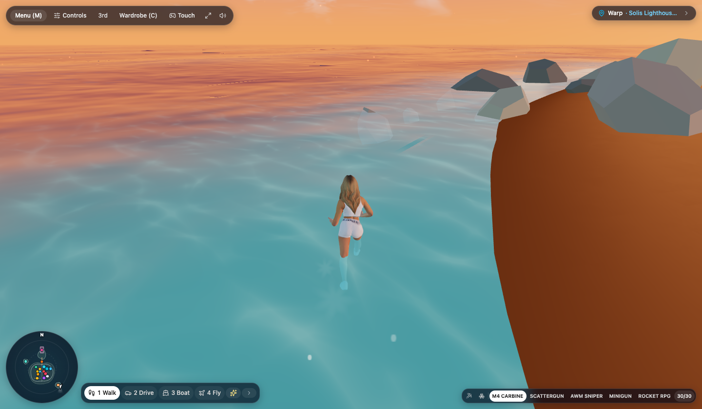 | 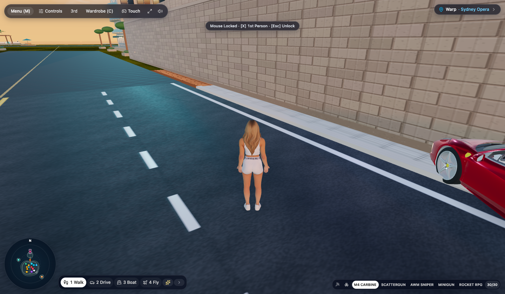 |

---

## AAA World Horizon Upgrade — Expanded Island, Ocean Shaders, Swimming & Animated Wonder Pier

- **Expanded Main Island (+30.7% Plateau / +33.8% Coastal Footprint)**: Sculpted coastal headlands, wider golden beaches (`44–79m`), flush travertine coastal promenades, 4 headland bluff overlooks with pergolas, new waterfront resort towers with rooftop gardens/pools, unobstructed airport climb-out corridor, and Island II Arrival Promenade pergolas.
- **AAA PBR Textures, Ocean Water Shader & World Fanfare**: Domain-warped multi-directional FBM ocean swells with crystal aquamarine-to-sapphire depth ramp, shallow caustics, and multi-band breaking shoreline surf foam; sun-weathered slate-charcoal asphalt & honed travertine textures; smooth C¹ analytical terrain normals; continuous harbor fireworks, sweeping Art-Deco premiere searchlights, celebratory fountain jets, festive bunting, and soaring seabird flocks.
- **Fluid Two-State Ocean Swimming & Character Polish**: Horizontal prone freestyle front-crawl (high-elbow arm recovery, 6-beat flutter kick, torso roll, breathing head turn, sprint cadence) + upright treading water with soft-feathered ripple/wake textures and fine sea-spray droplets; relaxed natural standing idle, crisp walk/jog/sprint & jump/landing animation, expressive emotes, and automatic 3rd-person camera restore on coaster exit.
- **Animated Wonder Ocean Pier Amusement Park**: Chasing Art-Deco marquee bulbs, honed travertine entrance apron, animated midway booths (`TICKETS`, `ARCADE` CRT screens, `CHURROS`, `ICE CREAM` spinning cone, `RING TOSS` prize wheel, `SKY BAR`), walkable Grand Riviera Carousel with sculpted curved steeds, Solaris Sky Wheel open-windowed panoramic cabins with coaxial spoke LEDs, Cyclone Pier Coaster FPV, and the swinging **Azurea Galleon Pendulum Ship**.

| Expanded Main Island Aerial & Ocean | Midtown Boulevard & World Fanfare | Crystal Ocean Shoreline Surf Foam | Active Freestyle Ocean Swimming |
| --- | --- | --- | --- |
| 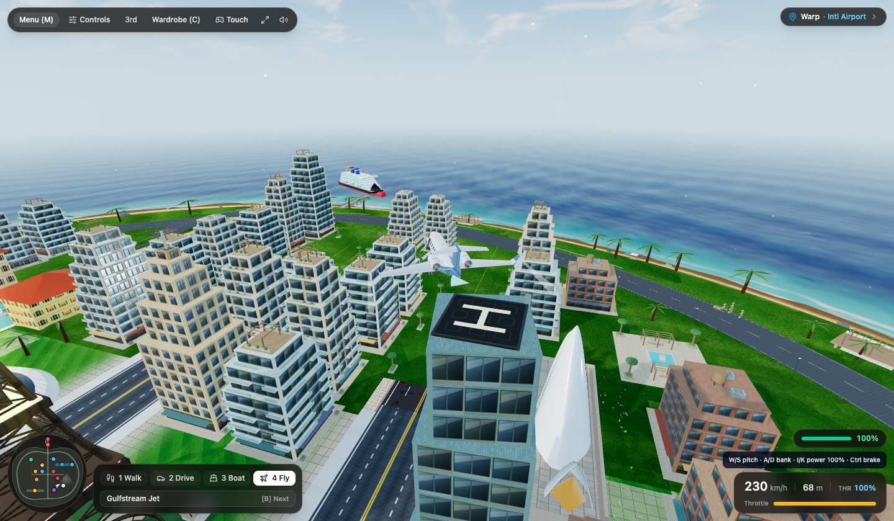 | 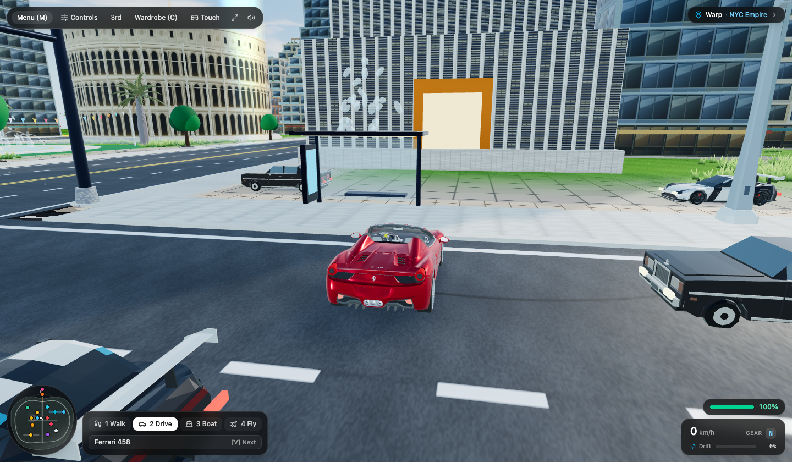 | 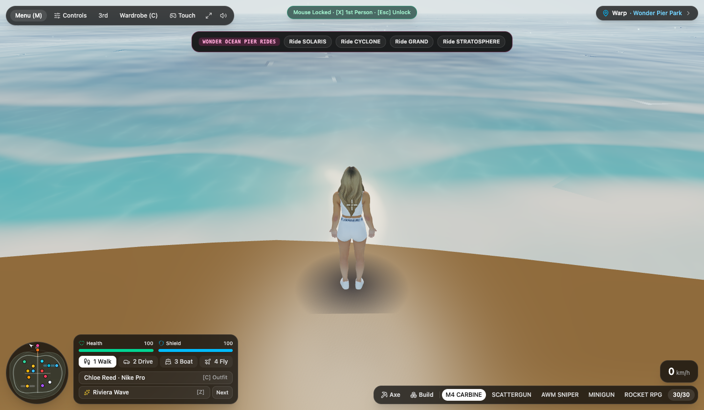 | 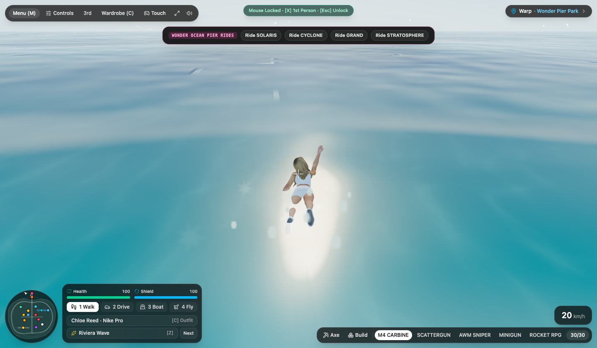 |

| Solaris Sky Wheel Panoramic Cabin | Wonder Pier Midway & Sculpted Carousel | Cyclone Coaster Front-Row FPV | Character Emote & Slate Boulevard |
| --- | --- | --- | --- |
| 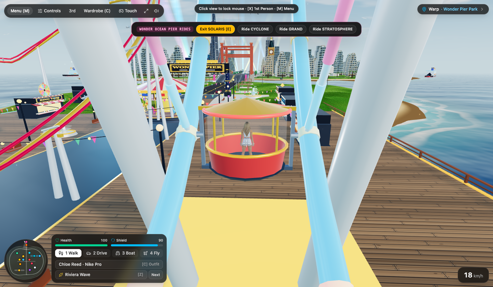 | 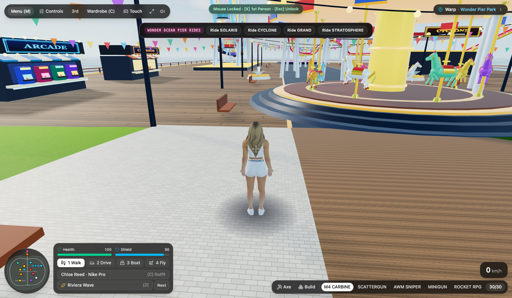 | 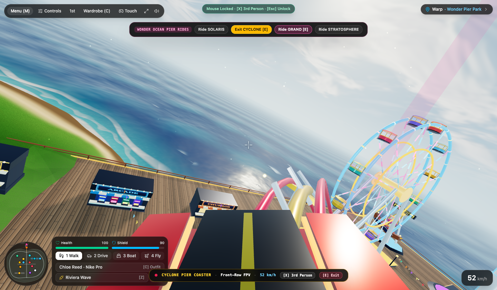 | 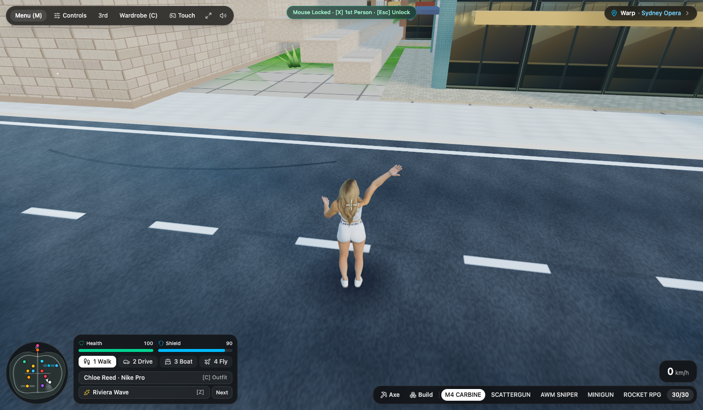 |

---

## 0. AAA Wonder Ocean Pier, Front-Row Coaster FPV, Forza Drift & Pointer Lock

- **AAA Wonder Ocean Pier Theme Park**: Sun-weathered teak boardwalk PBR planks, wooden safety railings, ornate Art-Deco **`WONDER PIER`** entrance marquee arch, 6 striped midway carnival & food booths (`TICKETS`, `ARCADE`, `CHURROS`, `ICE CREAM`, `RING TOSS`, `SKY BAR`), draped warm Edison string lights, crimson-and-cream striped Grand Carousel, radial LED Solaris Sky Wheel, and steel A-frame Cyclone Pier Coaster.
- **True Front-Row First-Person Roller Coaster POV**: Boarding the **Cyclone Pier Coaster** (`[E]` or `Ride Cyclone`) automatically seats you in the front row with a Frenet-banked camera, sculpted glossy crimson/carbon nose hood, glowing orange-red LED strips, padded black-and-gold lap restraint bar, mouse free-look (`±55°` yaw / `±35°` pitch), dynamic `64° → 86°` speed FOV, and live telemetry HUD (`[X]` toggles 3rd-person, `[E]` exits).
- **Forza-Grade Drift Physics, True Strafe Walking & Bulletproof Pointer Lock**: Fixed inverted `A`/`D` strafing (`computeFootWishVelocity` right-handed `F × U`), counter-steer-balanced supercar drifting with momentum preservation and turbo exit boost, and direct canvas pointer lock (`Mouse Locked · [Esc] Unlock`) with 1:1 mouse deltas on foot, in 1st-person, and on rides.

| AAA Wonder Ocean Pier Boardwalk | Front-Row Coaster FPV (Banked Turn) | Front-Row Coaster FPV (Ocean Climb) |
| --- | --- | --- |
| 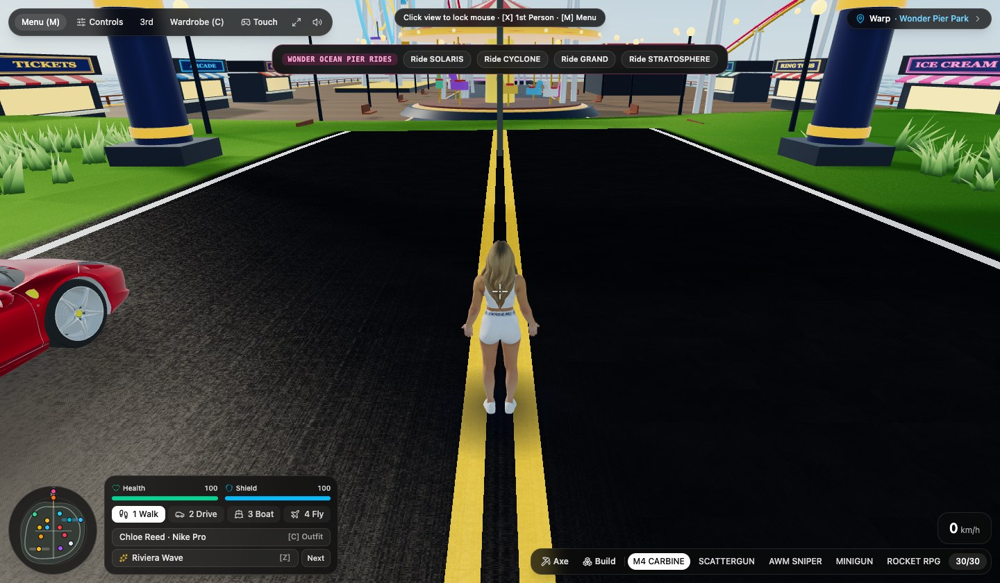 | 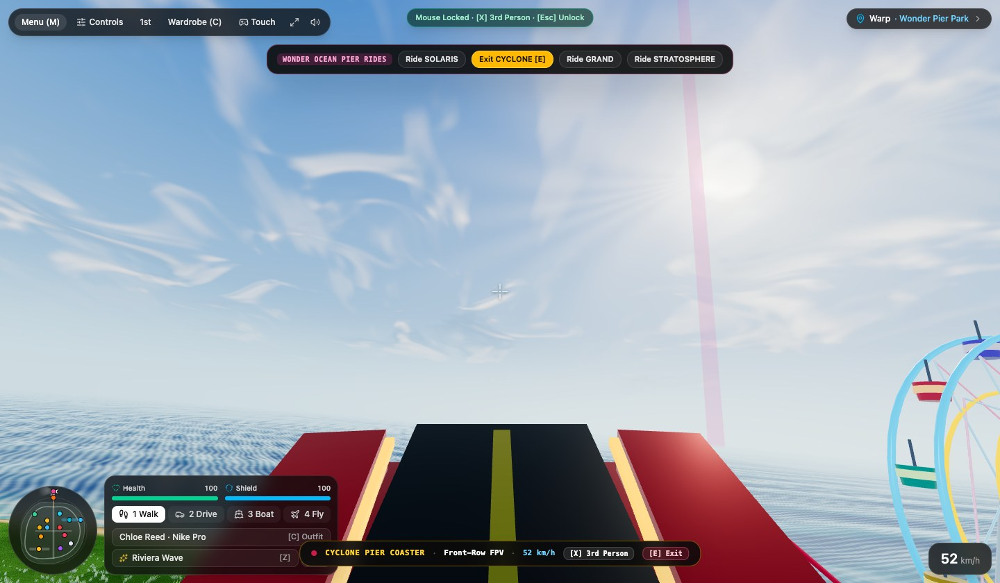 | 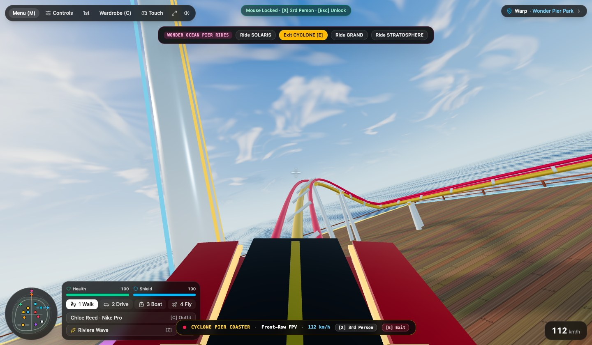 |

| Forza-Style Supercar Handling | Pointer-Lock 1st-Person & True Strafe |
| --- | --- |
| 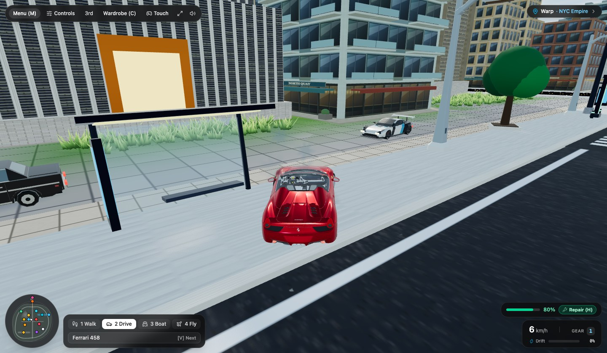 | 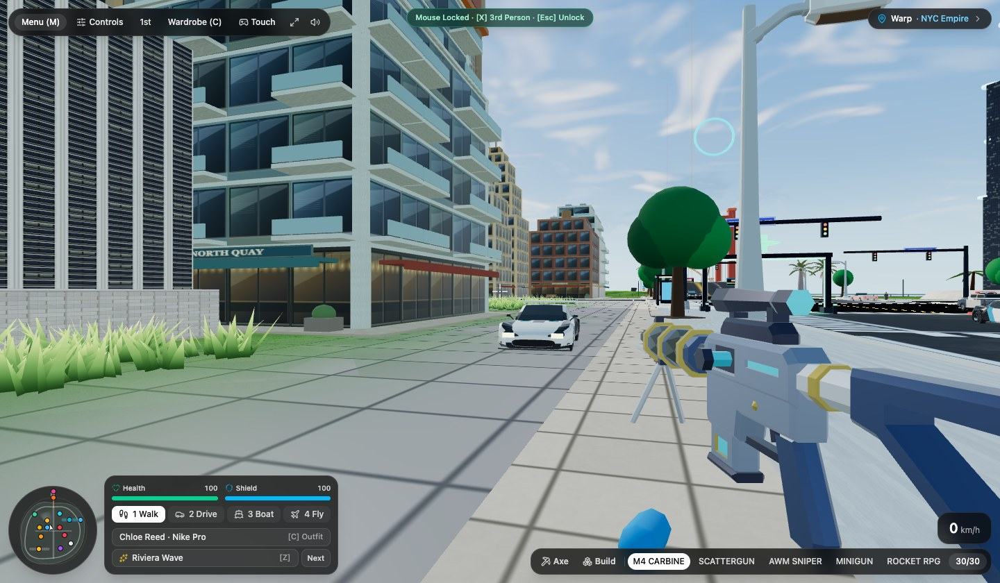 |

---

## 1. Flagship `v3.1` Heroes, Costumes & Kit Colorways

- **Chloe Reed (`v3.1` HD)** with 5 costumes (`Nike Pro Base`, `Emerald Club`, `Silver Spider`, `Varsity Sport`, `Holiday Velvet`) and **Lola Quinn (`v3.1` HD)** with 4 costumes (`Nike Pro Base`, `Bomber Street`, `Moto Leather`, `Holiday Velvet`), plus 7 real-time **Athletic Kit Colorways** on their Nike Pro bases (`uKitTint` shader hook).
- **Male `v3.1` HD Heroes**: `Marcus Vance` and `Liam Sterling`.
- **Natural Shading & Mixamo Mocap**: Preserves baked normal maps, applies matte-satin skin/cotton calibration, auto-aligns `+Z` facing, and retargets `idle`/`walk`/`run`/`SambaDance` motion capture clips across all Mixamo rigs. On-demand lazy GLB loading keeps startup fast.

| Chloe Reed (Azurea Kit) | Chloe Reed (Emerald Club) | Lola Quinn (Bomber Street) | Marcus Vance & Liam Sterling |
| --- | --- | --- | --- |
|  | 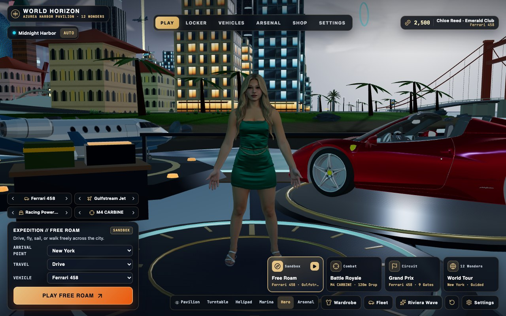 |  |  |

---

## 2. Dense 22,000-Clump 3D Grass, Supercar Driving & Pointer-Lock Shooting

- **Lush 22,000-Clump 7-Blade Grass** with GPU hardware distance LOD culling (`78–125m` taper) and natural fescue/olive/soil color harmony across parks, boulevards, and Island II.
- **Snappy Supercar Driving**: Low-speed steering response, high-speed turn authority, launch torque curve, progressive slip & drift chase camera.
- **True Pointer-Lock 1st/3rd-Person Aim & Shooting**: Clicking locks the cursor for 1:1 mouse aim (`[Esc]` unlocks cursor without kicking to Menu), barrel-origin tracers, compact 1st-person viewmodel & muzzle flash, camera recoil kick, and 60fps reactive reticle spread.

| Supercar & Lush 3D Grass | First-Person Pointer-Lock Shooting |
| --- | --- |
| 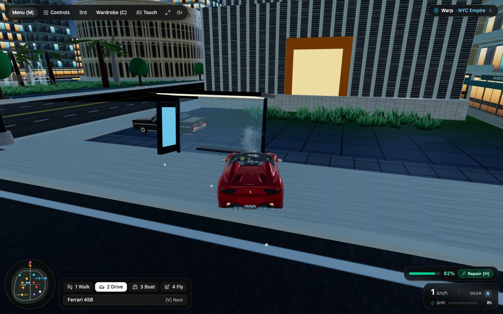 |  |

---

## 3. Localhost Tripo 3D Studio (`npm run tripo-studio`)

Run `npm run tripo-studio` to launch the local Tripo3D Asset Forge at `http://127.0.0.1:4321`.

- Defaults to **`v3.1-20260211` Flagship H3.1 HD** + `Detailed HD` textures + `36,000` face limit.
- **Automatic Mixamo Biped Rigging** (`animate_rig`, `spec: "mixamo"`, 23 joints) saving `.glb` files directly into `public/models/characters/` with an ACES Filmic sRGB Three.js 3D previewer.

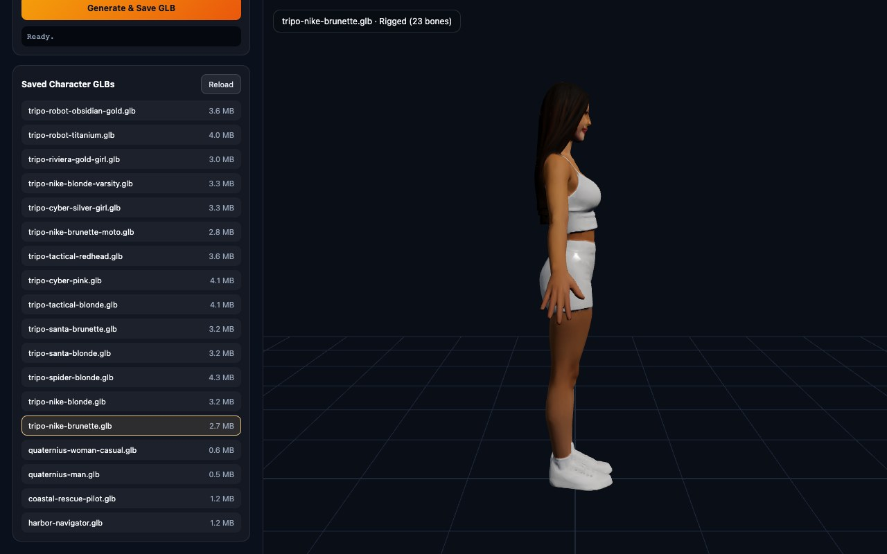

---

## 2. Five Selectable Emotes (Lobby & In-Game `[Z]`)

Choose any of the 5 procedural full-body emotes in the Wardrobe drawer, cycle them from the bottom-right Lobby utility bar, or trigger them on foot in-game with **`[Z]`** or the HUD Emote pill:

1. **Riviera Wave** (`WAVE`)
2. **Club Groove** (`DANCE`)
3. **Victory Spin** (`SPIN`)
4. **Champion Flex** (`FLEX`)
5. **Harbor Shuffle** (`SHUFFLE`)

---

## 3. Rotating Pavilion Lobby & 4 Dynamic Atmosphere Themes

All 4 lobby themes share a unified core layout with the bottom-right Game Options icon bar (`Overview`, `Turntable`, `Helipad`, `Marina`, `Hero`, `Arsenal`, `Wardrobe`, `Fleet`, `Emote`, `Reset`, `Settings`).

| Theme | Preview |
| --- | --- |
| **Sunlit Riviera** | 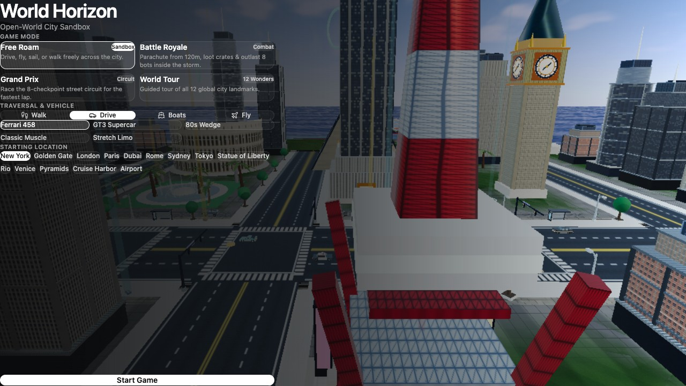 |
| **Sunset Boardwalk** | 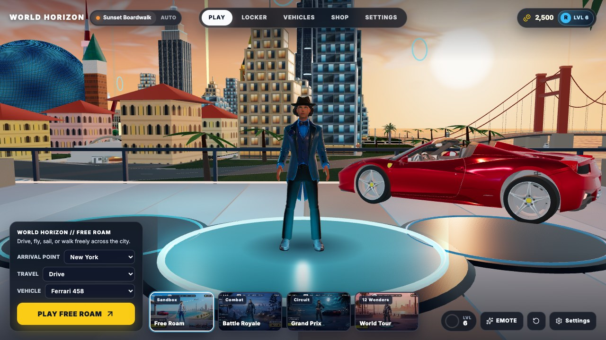 |
| **Tactical Overlook** | 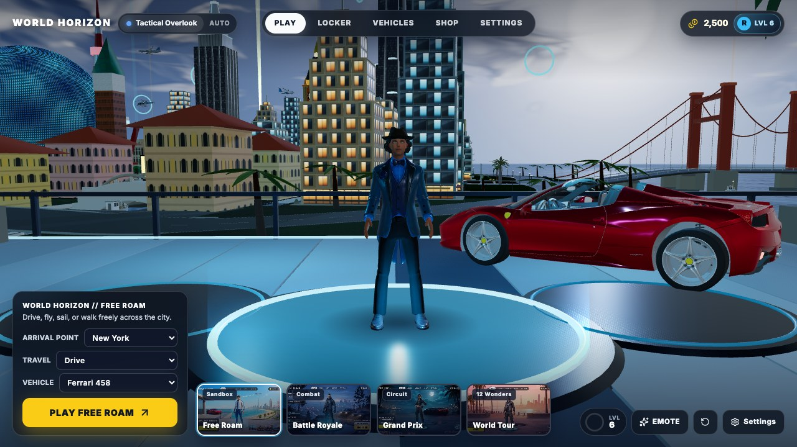 |
| **Midnight Harbor** |  |

---

## 4. Wonder Ocean Pier Amusement Park (Ridable)

Extending off Island II into the open ocean, the **Wonder Ocean Pier** features 4 ridable attractions (`[E]` to board/exit):
- **Solaris Ferris Wheel** (rotating gondolas with panoramic coastline views)
- **Cyclone Pier Coaster** (elevated track loop over the water)
- **Grand Carousel** & **Apex Drop Tower**

| Pier Overview | Solaris Ferris Wheel | Cyclone Coaster |
| --- | --- | --- |
|  |  | 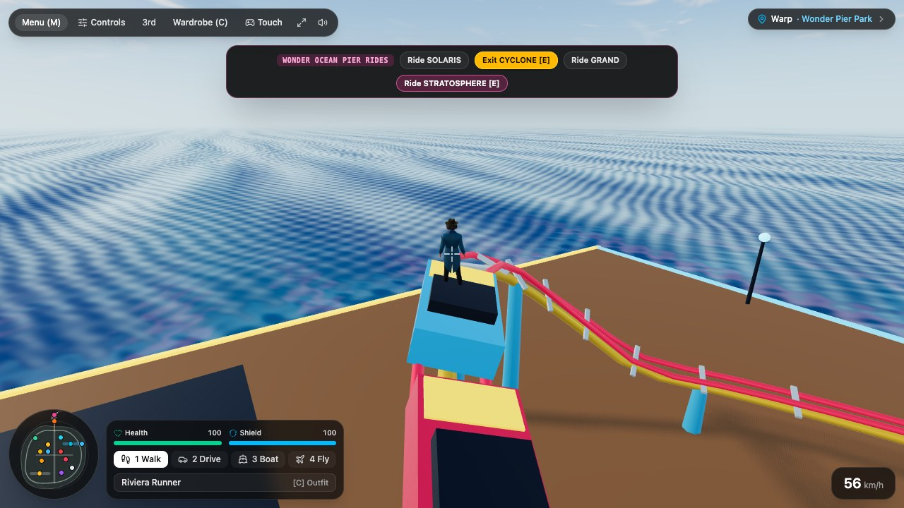 |

---

## 5. Open-World Modes, Landmarks & Fleet

| Mode / Landmark | Screenshot |
| --- | --- |
| **Free Roam Avenue** |  |
| **Grand Prix (Golden Gate)** | 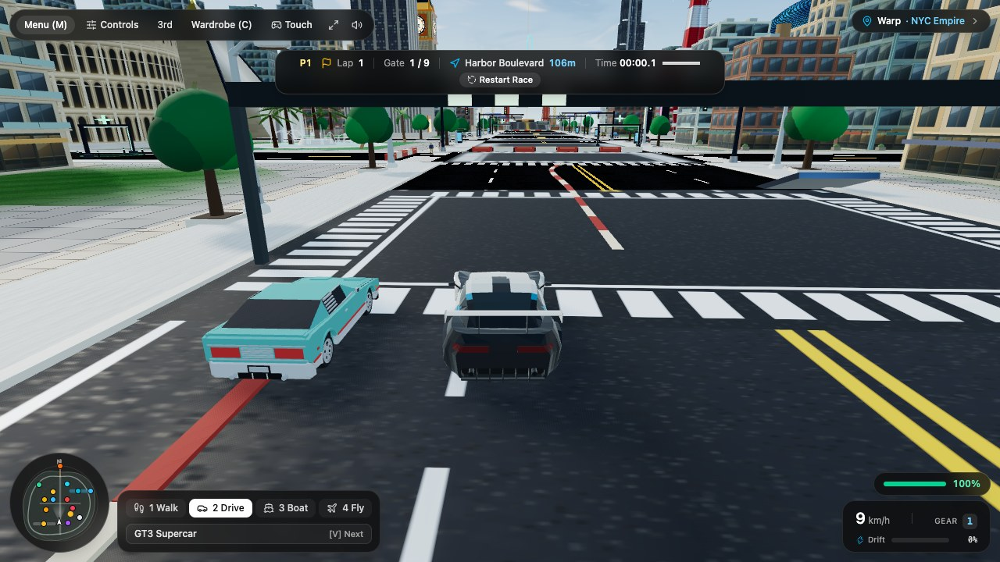 |
| **Battle Royale Skydrop** |  |
| **World Tour · Colosseum** | 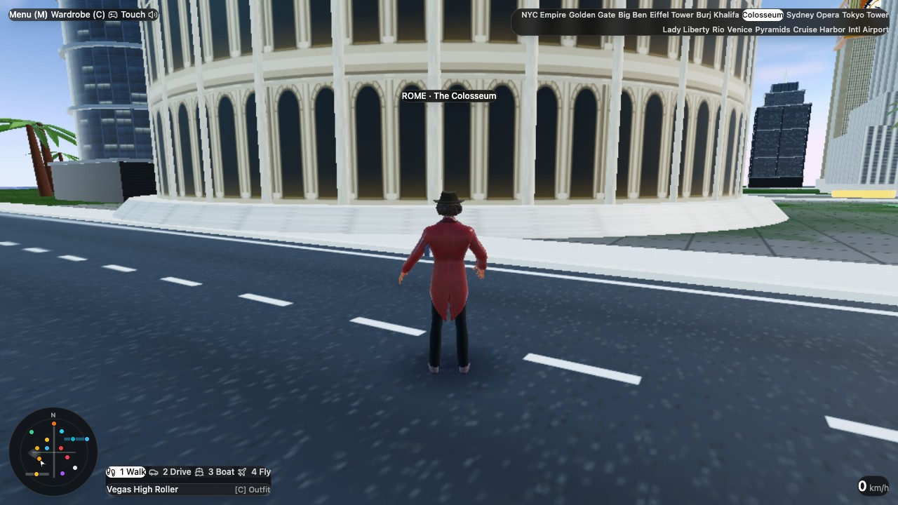 |
| **World Tour · Sydney Opera House** | 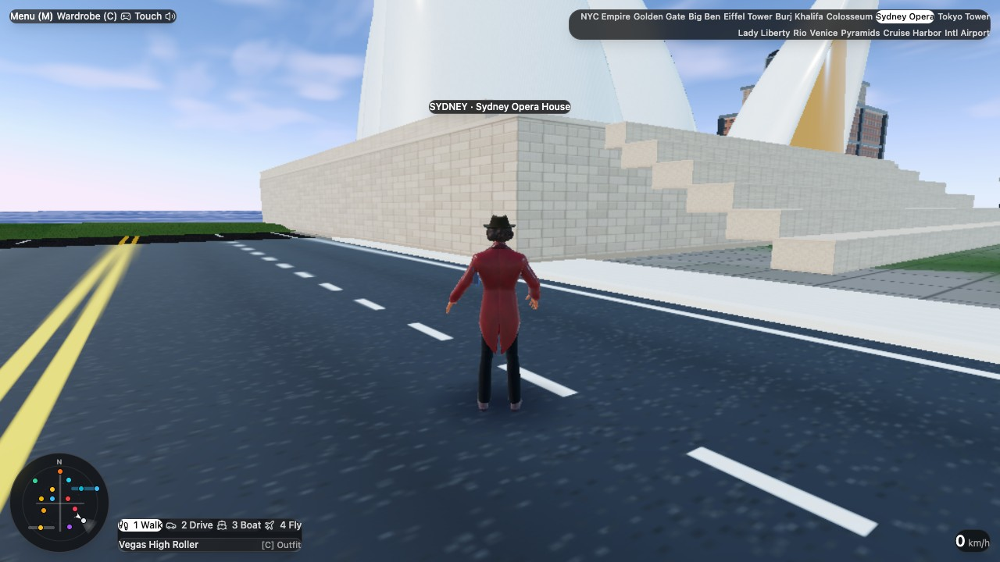 |
| **World Tour · Eiffel Tower** |  |
| **World Tour · Big Ben** |  |
| **Maritime · Cruise Ship & Ocean** |  |
| **Aviation · Helicopter** | 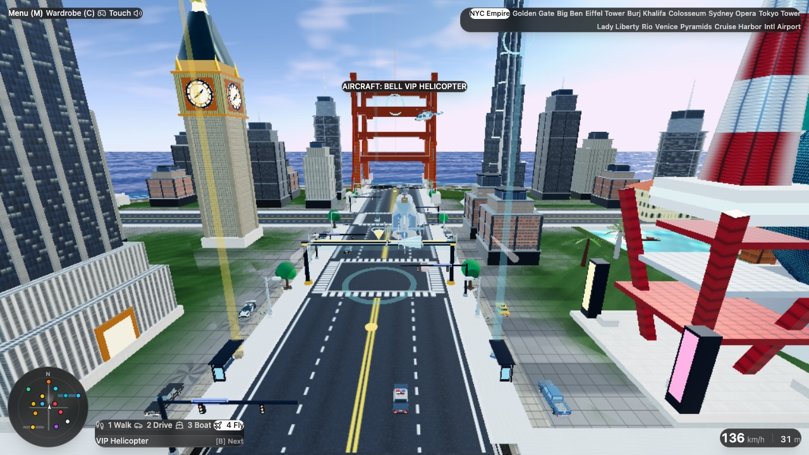 |
| **Aviation · Gulfstream Coast** |  |
| **Mobile Touch Controls** |  |
